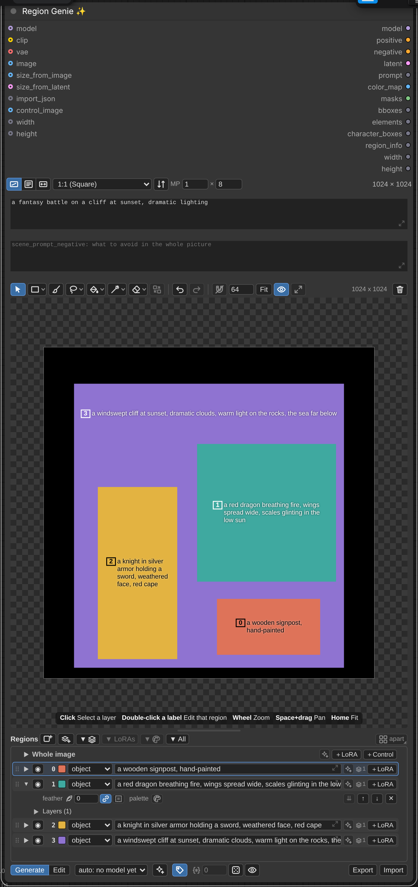
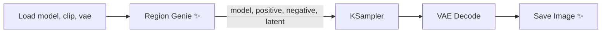
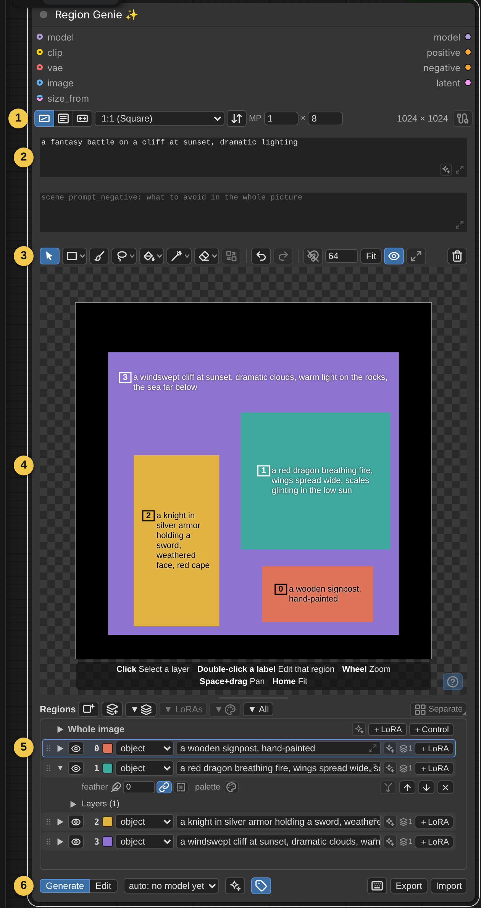
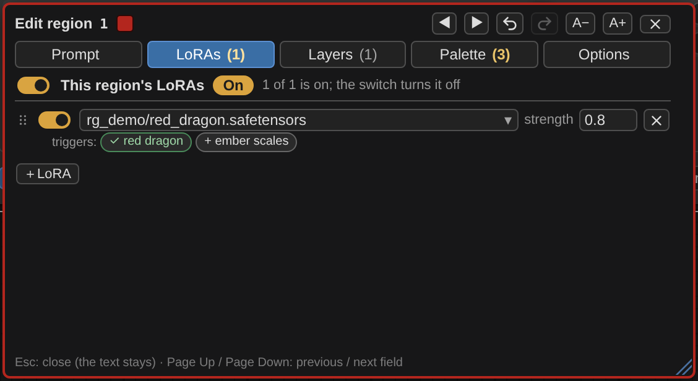
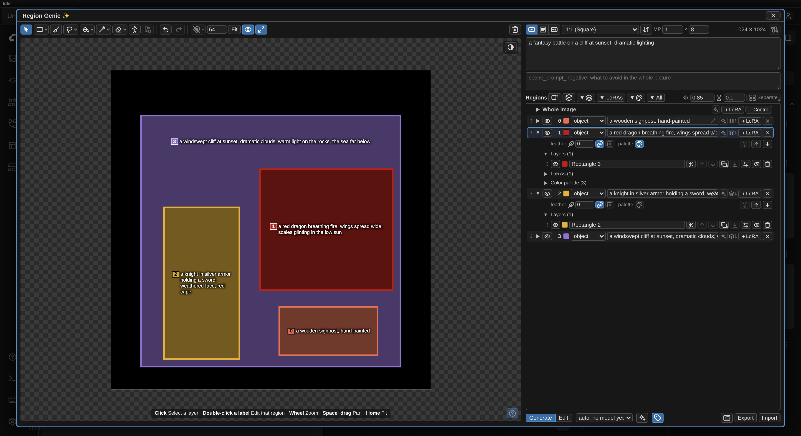
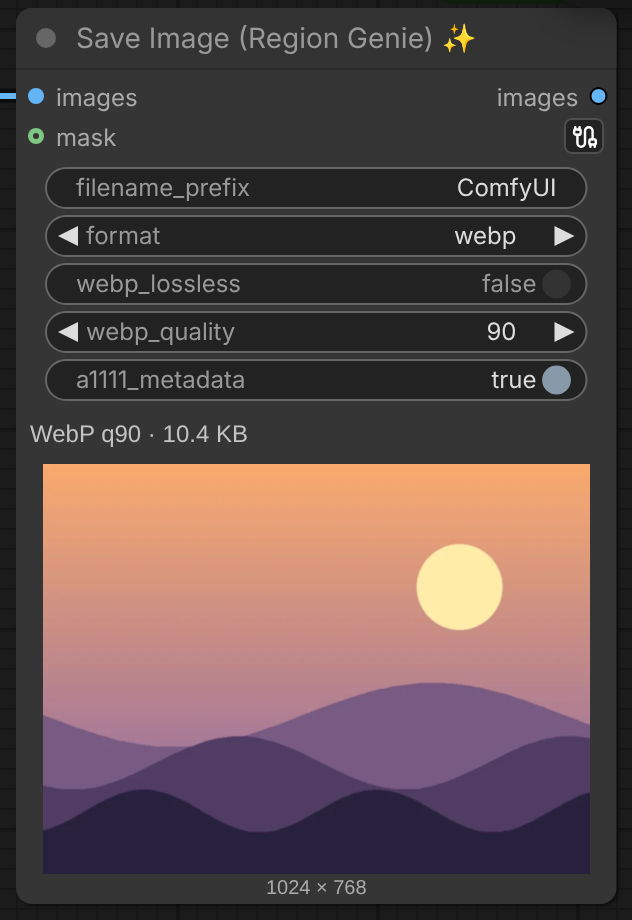

# Region Genie ✨

**Regional prompting and regional LoRAs for ComfyUI.** Draw regions on a canvas, type a prompt for each, and the node tells the model what goes where.

## Contents

- [What you can do with it](#-what-you-can-do-with-it)
- [Supported models](#-supported-models)
- [Install](#-install)
- [Quick start](#-quick-start)
- [Feature tour](#-feature-tour)
- [The nodes](#-the-nodes)
- [Manual](#-manual)
- [Languages](#-languages)
- [For developers](#-for-developers)
- [License](#-license)

## ✨ What you can do with it

- **Place prompts by region.** A knight here, a dragon there: each region gets its own prompt.
- **Give a region its own LoRA.** A character or style LoRA acts only inside the region you choose.
- **Draw any shape.** Boxes, ellipses, stars, brush strokes, lasso outlines, fills, or objects picked out of a photo.
- **Guide the layout.** ControlNet-style control (depth, canny, color map) from the same node.
- **Edit existing pictures.** Paint over a photo and change only the regions you mark.
- **Let an LLM write for you.** A local LLM can expand short region prompts when the workflow runs.
- **Save smaller files.** A Save Image node with WebP, JPEG, AVIF and PNG settings, and settings text other tools can read.

## ✨ Supported models

| Model | How regions are placed |
|---|---|
| MOSS-Image | Its own layout format: each region's box and prompt |
| Ideogram 4 | Its own caption format: each region's box and prompt |
| Krea 2, Flux.1, Flux.2 / Klein, Flux 3 | By attention: the **Separate** button ties each prompt to its region (it turns on by itself) |
| Anima, SDXL, SD1.5 | By attention, as above |

The node picks the right format from the connected model. See [Prompt formats by model](docs/region-genie.md#prompt-formats-by-model) for the details.

## ✨ Install

- **ComfyUI Manager:** choose *Install via Git URL*, paste this repository's address, then restart ComfyUI.
- **By hand:** clone or unzip into `ComfyUI/custom_nodes/` (the folder is `ComfyUI-Region-Genie`), then restart.

Nothing else is needed. These extras are optional:

| Extra | What it adds |
|---|---|
| [ComfyUI Impact Pack](https://github.com/ltdrdata/ComfyUI-Impact-Pack) | Wildcards in every prompt field |
| [rgthree-comfy](https://github.com/rgthree/rgthree-comfy) | Folders in the model-file menus |
| A tag autocomplete pack | Tag suggestions while you type (see [Setup notes](docs/setup-notes.md)) |

## ✨ Quick start

1. Add the **Region Genie** node (search for "genie"). Connect your loader's `model`, `clip` and `vae` to it.
2. Set the image size in the row at the top of the node.
3. Press the add-region button under the canvas and drag a box. Type that region's prompt in the list. Repeat for each region.
4. Describe the whole picture in `scene_prompt_positive`.
5. Connect the node's `model`, `positive`, `negative` and `latent` outputs to your sampler, and run.

**Prefer a ready-made workflow?** Drag [`examples/region-genie-starter-sdxl.json`](examples/) onto ComfyUI and pick your own SDXL checkpoint.

1. **Sockets and image size**
2. **Scene prompts:** the whole picture, and what to avoid
3. **Tools:** select, shapes, brush, lasso, fill, magic wand, eraser, arrange
4. **Canvas:** where you draw the regions
5. **Region list:** one row per region, with its prompt
6. **Bottom bar:** Generate / Edit, the model, LLM settings, shortcuts, Export / Import

The node helps as you go:

- An empty canvas shows the first steps.
- The line at the bottom of the canvas shows the keys of the tool in use.
- Press **?** over the node for every shortcut.
- Point at any button for what it does.

## ✨ Feature tour

### Regions on a canvas

Draw regions with shapes, a brush, a lasso or a fill. Each region is one color with one prompt. Layers let you build a region from several pieces, cut holes, and move or resize things later. On a connected photo, the magic wand and **Select object** (SAM 3.1) pick out areas for you.

→ [Region Genie (the node)](docs/region-genie.md)

### Regional LoRAs

**＋LoRA** on a region adds a LoRA that acts only inside that region. **＋LoRA** on *Whole image* adds one for the whole picture. Trigger words show as chips you can click into the prompt.

→ [Regional LoRAs](docs/regional-loras.md)

### Control

**＋Control** adds a row that makes the model follow a map: depth, canny, a color map of your regions, or a map of your own. The node picks the right control files for your model.

→ [Control (ControlNet)](docs/control.md)

### Edit Mode

Switch the bottom bar to **Edit**, connect a picture, and paint over the parts to change. Each region can be set to change or to stay exactly as it is.

→ [Edit Mode](docs/edit-mode.md)

### LLM Prompt Enhancer

The sparkles button on a region lets a local LLM rewrite that prompt when the workflow runs. Your own text stays, and you can go back to it at any time.

→ [LLM Prompt Enhancer](docs/llm-prompt-enhancer.md)

### Wildcards

With ComfyUI Impact Pack installed, every prompt field takes its wildcards: `__name__`, `{red|blue|green}` and the rest.

→ [Wildcards](docs/wildcards.md)

### Room to work

The **large editor** opens the same editor in a window that fills the page. Every prompt box has a pop-up editor for longer text.

→ [Node size and the large editor](docs/region-genie.md#node-size-and-the-large-editor)

### Save Image

Saves as PNG, WebP, JPEG or AVIF with the quality you pick, and shows the file sizes. It also writes the settings (prompt, seed, steps, sampler, model) as text that A1111, Forge and Civitai can read.

→ [Save Image (Region Genie)](docs/save-image.md)

## ✨ The nodes

All nodes are in the **Region Genie** category, and their names end in ✨.

| Node | What it does |
|---|---|
| **Region Genie** | The canvas editor: regions, prompts, regional LoRAs, Control and Edit Mode |
| **Regional LoRAs** | Regional LoRAs from a batch of masks, without the canvas |
| **Mask Picker** | Picks one mask (and its prompt) from a batch of masks |
| **BBoxes to Masks** | Turns layout boxes from other nodes into masks |
| **Create Hook LoRA (Quantized)** | ComfyUI's "Create Hook LoRA" for int8 / fp8 models |
| **Save Image (Region Genie)** | Saves in smaller formats, with settings text for other tools |

## ✨ Manual

| Page | What it covers |
|---|---|
| [Region Genie (the node)](docs/region-genie.md) | Image size, regions, layers, tools, text boxes, outputs, prompt formats, Settings |
| [Regional LoRAs](docs/regional-loras.md) | LoRAs per region, keeping regions apart, the Regional LoRAs node |
| [Control (ControlNet)](docs/control.md) | Control rows, control maps, the files each model uses |
| [Edit Mode](docs/edit-mode.md) | Image-to-image with regions, Edit rows and edit LoRAs |
| [LLM Prompt Enhancer](docs/llm-prompt-enhancer.md) | Writing and improving prompts with a local LLM |
| [Wildcards](docs/wildcards.md) | Impact Pack wildcards in every prompt field |
| [BBoxes to Masks and Mask Picker](docs/mask-nodes.md) | The two small mask nodes |
| [Save Image (Region Genie)](docs/save-image.md) | Formats, quality, transparency, settings text for other tools |
| [Setup notes](docs/setup-notes.md) | Finding the nodes, tag autocomplete, coming from Regional Mask Kit |

Inside ComfyUI, select a node and press **Node Info** for a short guide to it.

## ✨ Languages

The nodes' names, inputs, outputs, tooltips and Settings are translated into Chinese, Japanese, Korean and Spanish (machine-drafted so far), and follow ComfyUI's own language setting. The canvas editor itself is in English. See [Languages](docs/languages.md).

## ✨ For developers

- [`docs/HANDOFF.md`](docs/HANDOFF.md): the code layout and design decisions
- [`docs/CHANGELOG.md`](docs/CHANGELOG.md): the history
- [`tests/README.md`](tests/README.md): the tests
- [`docs/HARDWARE-CHECKLIST.md`](docs/HARDWARE-CHECKLIST.md): what still needs checking on a real GPU

## ✨ License

[GPL-3.0](LICENSE), the same license as ComfyUI.
