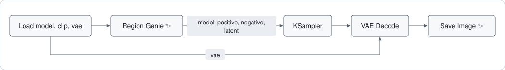
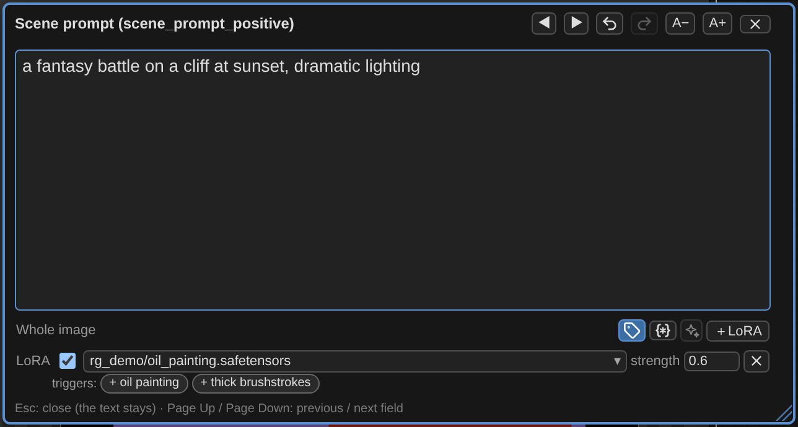
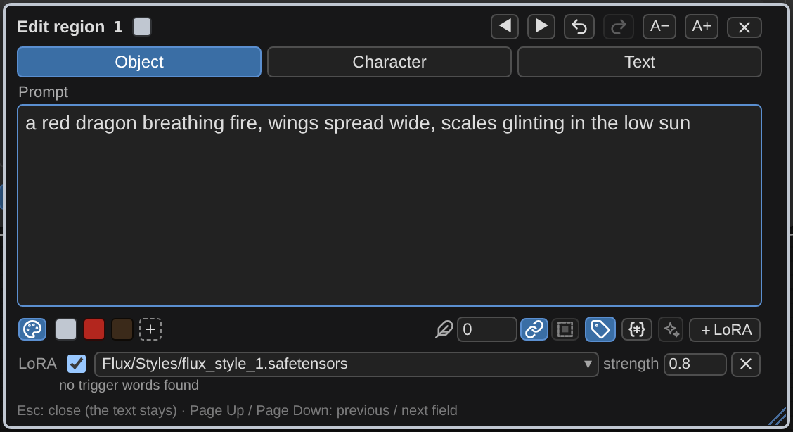
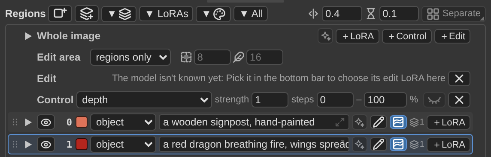
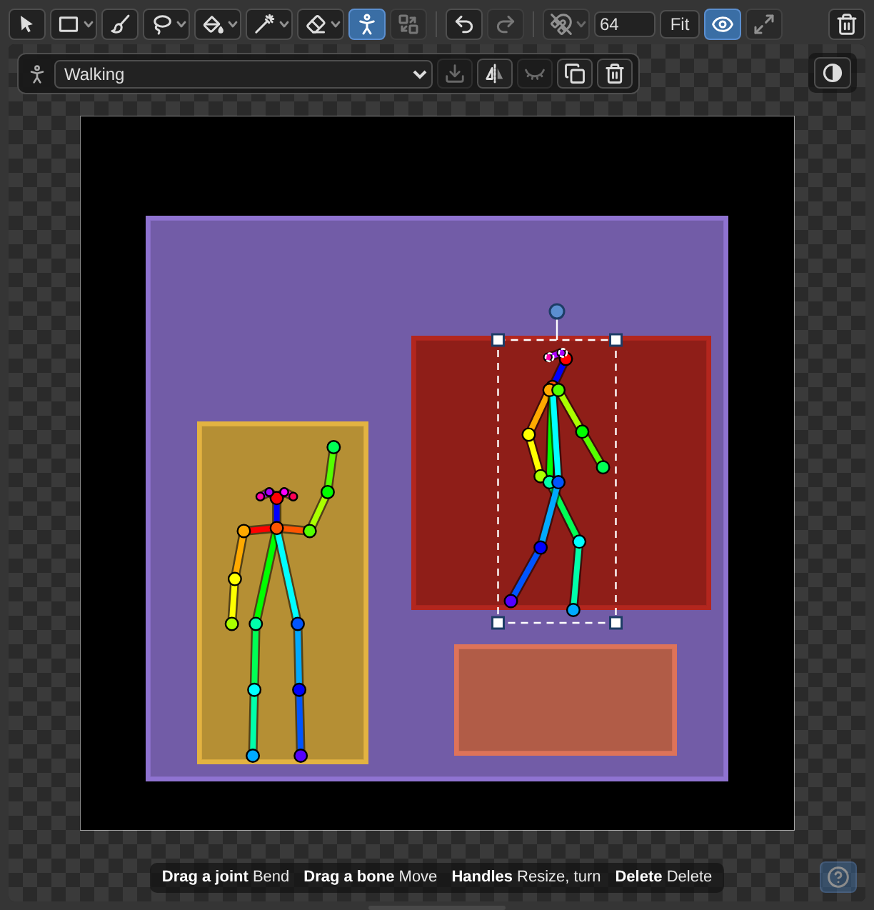
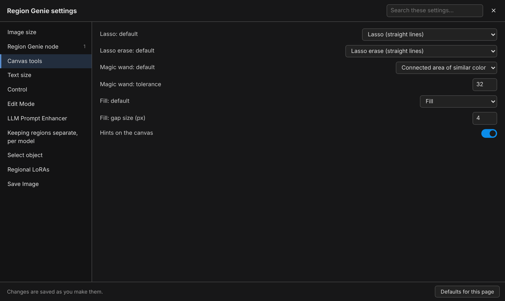
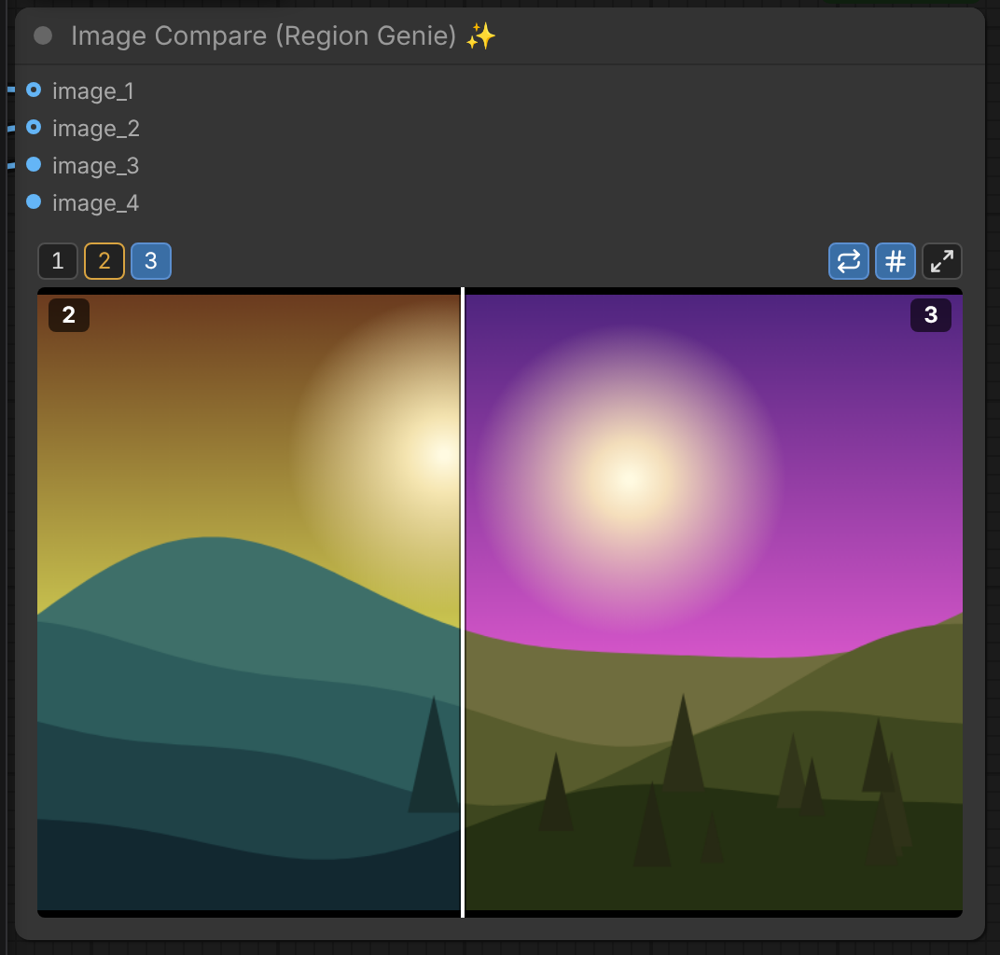

# Region Genie ✨

**Regional prompting and regional LoRAs for ComfyUI.** Draw regions on a canvas, type a prompt for each, and the node tells the model what goes where.

## Contents

- [What you can do with it](#-what-you-can-do-with-it)
- [Supported models](#-supported-models)
- [Install](#-install)
- [Quick start](#-quick-start)
  - [Example workflows](#example-workflows)
- [Feature tour](#-feature-tour)
  - [Regions on a canvas](#regions-on-a-canvas)
  - [Pop-up text editors](#pop-up-text-editors)
  - [Regions from a picture](#regions-from-a-picture)
  - [Layers and Arrange](#layers-and-arrange)
  - [Colors and palettes](#colors-and-palettes)
  - [Image size](#image-size)
  - [Regional LoRAs](#regional-loras)
  - [Separation and until](#separation-and-until)
  - [Control](#control)
  - [Poses](#poses)
  - [Edit Mode](#edit-mode)
  - [LLM Prompt Enhancer](#llm-prompt-enhancer)
  - [Wildcards](#wildcards)
  - [Room to work](#room-to-work)
  - [Shortcuts and Settings](#shortcuts-and-settings)
  - [Export and import](#export-and-import)
  - [Save Image](#save-image)
  - [Tiled upscale](#tiled-upscale)
  - [Image compare](#image-compare)
- [The nodes](#-the-nodes)
- [Manual](#-manual)
- [Languages](#-languages)
- [For developers](#-for-developers)
- [License](#-license)

## ✨ What you can do with it

- **Place prompts by region.** A knight here, a dragon there: each region gets its own prompt.
- **Or use no regions at all.** With an empty canvas the node is a plain text-to-image prompt node, so one workflow serves both.
- **Write in a large editor.** Every prompt opens in a pop-up editor with undo, LoRAs, wildcards and the LLM button at hand.
- **Give a region its own LoRA.** A character or style LoRA acts only inside the region you choose.
- **Draw any shape.** Boxes, ellipses, stars, brush strokes, lasso outlines and fills.
- **Start from a picture.** Click an object in a photo to make it a region, or turn a color sketch into regions.
- **Guide the layout.** ControlNet-style control (depth, canny, color map) from the same node.
- **Pose your characters.** Draw stick figures on the canvas and the model follows their poses.
- **Edit existing pictures.** Paint over a photo and change only the regions you mark.
- **Let an LLM write for you.** A local LLM can expand short region prompts when the workflow runs.
- **Save smaller files.** A Save Image node with WebP, JPEG, AVIF and PNG settings, and settings text other tools can read.
- **Upscale in tiles.** One node enlarges an image and redraws it with your model in blended tiles, on any model.

## ✨ Supported models

| Model | How regions are placed |
|---|---|
| MOSS-Image | Its own layout format: each region's box and prompt |
| Ideogram 4 | Its own caption format: each region's box and prompt |
| Krea 2, Flux.1, Flux.2 / Klein, Flux 3 | By attention: the **Separate** button ties each prompt to its region (it turns on by itself) |
| Anima, SDXL (and SDXL-based models such as Illustrious-XL and NoobAI-XL), SD1.5 | By attention, as above |

The node picks the right format from the connected model. See [Prompt formats by model](docs/region-genie.md#prompt-formats-by-model) for the details.

## ✨ Install

- **ComfyUI Manager (recommended):** open the Manager, search for **Region Genie**, click **Install**, then restart ComfyUI.
  - Updates arrive the same way: the Manager shows when a newer version is out.
- **Command line:** `comfy node install region-genie` (with [comfy-cli](https://docs.comfy.org/comfy-cli/getting-started)), then restart.
- **By hand:** clone or unzip this repository into `ComfyUI/custom_nodes/`, then restart. Update with `git pull`.

Install it one way only. If you cloned it by hand earlier, delete that folder before installing through the Manager, or the pack is loaded twice.

The pack is listed in the [Comfy Registry](https://registry.comfy.org/nodes/region-genie) as `region-genie`.

Nothing else is needed. These extras are optional:

| Extra | What it adds |
|---|---|
| [ComfyUI Impact Pack](https://github.com/ltdrdata/ComfyUI-Impact-Pack) | Wildcards in every prompt field |
| [rgthree-comfy](https://github.com/rgthree/rgthree-comfy) | Folders in the model-file menus |
| A tag autocomplete pack | Tag suggestions while you type (see [Setup notes](docs/setup-notes.md)) |

## ✨ Quick start

<picture>
  <source media="(prefers-color-scheme: dark)" srcset="docs/images/quickstart-dark.svg">
  <source media="(prefers-color-scheme: light)" srcset="docs/images/quickstart-light.svg">
  
</picture>

1. Add the **Region Genie** node (search for "genie"). Connect your loader's `model`, `clip` and `vae` to it.
2. Set the image size in the row at the top of the node: by aspect ratio, from your presets list, or by hand (width and height, with a step size for their arrows).
3. Press the add-region button under the canvas and drag a box. Type that region's prompt in the list, or press ⤢ on the prompt for a [large pop-up editor](#pop-up-text-editors). Repeat for each region.
4. Describe the whole picture in `scene_prompt_positive`.
5. Connect the node's `model`, `positive`, `negative` and `latent` outputs to your sampler, and run.

**No regions needed.** Leave the canvas empty and the node works as a normal text-to-image setup: `scene_prompt_positive` and `scene_prompt_negative` are your prompts, the size row sets the image size, and **＋LoRA** on *Whole image* adds LoRAs. Add regions only for the pictures that need them; the workflow stays the same.

**Prefer a ready-made workflow?** There is one for every supported model: → [Example workflows](#example-workflows)

1. **Sockets and image size**
2. **Scene prompts:** the whole picture, and what to avoid
3. **Tools:** select, shapes, brush, lasso, fill, magic wand, eraser, pose, arrange
4. **Canvas:** where you draw the regions
5. **Region list:** one row per region, with its prompt
6. **Bottom bar:** Generate / Edit, the model, LLM settings, shortcuts, Export / Import

The node helps as you go:

- An empty canvas shows the first steps, and that the node also works without regions.
- The line at the bottom of the canvas shows the keys of the tool in use.
- Press **?** over the node for every shortcut.
- Point at any button for what it does.

### Example workflows

One ready-made workflow for each supported model: loaders, the Region Genie node, the sampler, Save Image.

| Workflow | What it shows |
|---|---|
| [MOSS-Image: layout](example_workflows/01-moss-image-layout.json) | 3 regions, in MOSS-Image's layout format |
| [MOSS-Image: plain text-to-image](example_workflows/02-moss-image-text-to-image.json) | No regions: the scene prompts only |
| [Krea 2 (Turbo)](example_workflows/03-krea-2.json) | 3 regions |
| [Ideogram 4](example_workflows/04-ideogram-4.json) | 3 regions, in Ideogram 4's caption format |
| [Flux.1 dev](example_workflows/05-flux-1-dev.json) | 3 regions |
| [Flux.2 dev](example_workflows/06-flux-2-dev.json) | 3 regions |
| [Flux.2 Klein (4B, distilled)](example_workflows/07-flux-2-klein.json) | 3 regions |
| [Flux 3 Klein](example_workflows/08-flux-3-klein.json) | 3 regions |
| [Anima](example_workflows/09-anima.json) | 3 regions |
| [SDXL (and SDXL-based models)](example_workflows/10-sdxl.json) | 3 regions |
| [SD1.5](example_workflows/11-sd-1-5.json) | 3 regions, 512 × 512 |

- **In ComfyUI:** open **Templates** and pick *ComfyUI-Region-Genie*. Or open a link above, download the file and drag it onto ComfyUI.
- **Model files:** each workflow has a note listing its files with download links. If yours have other names, pick them in the loaders.

→ [Example workflows in the manual](docs/region-genie.md#example-workflows)

## ✨ Feature tour

### Regions on a canvas

Draw regions with shapes, a brush, a lasso or a fill. Each region is one color with one prompt.

→ [Region Genie (the node)](docs/region-genie.md)

### Pop-up text editors

The easiest way to write prompts. Every text field opens in a large editor that floats over the page, so you can type long prompts without scrolling a small box.

**To open one:** press the arrows button (⤢) in the corner of any text field, or double-click a region's label on the canvas.

| Where | Control | What it does |
|---|---|---|
| Title bar | ◀ ▶ | Go to the previous / next text field without closing (also Page Up / Page Down) |
| | Undo / Redo | Take back or repeat your typing in this field (also Ctrl+Z, Ctrl+Y) |
| Text box | Ctrl+Up / Ctrl+Down | Raise or lower the weight of the word or tag at the cursor, or of the selected words: `(tag:1.05)` |
| | A− / A+ | Smaller / larger text |
| | Close | Closes the pop-up (also Esc). Your text always stays |
| Tabs | Prompt, LoRAs, Layers, Palette, Options | Everything a region holds, one tab each; the pop-up keeps its size when you switch |
| Region only | Object / Character / Text | What kind of region this is |
| Bottom row | Tag autocomplete | Tag suggestions while you type, on / off |
| | Wildcards | Insert a wildcard (with ComfyUI Impact Pack) |
| | LLM Prompt Enhancer | Let a local LLM rewrite this prompt when the workflow runs |
| LoRAs tab | ＋LoRA | Add a LoRA: for this region, or for the whole image on `scene_prompt_positive` |

Drag the title bar to move a pop-up, and the corner grip to resize it. It stays open while you draw.

→ [Text boxes and pop-up editors](docs/region-genie.md#text-boxes-and-pop-up-editors)

### Regions from a picture

Connect a picture to `image` and let the node find the regions:

- **Select object** (Q): click an object, or type what to find (`person`, `red car, dog`), and it becomes a region.
  - It uses SAM 3.1 and needs one model file ([download](https://huggingface.co/Comfy-Org/sam3.1/resolve/main/checkpoints/sam3.1_multiplex_fp16.safetensors), about 1.7 GB) in `ComfyUI/models/checkpoints`.
- **Magic wand** (W): click an area of similar color to add it.
- **Color map:** a sketch in flat colors becomes regions by itself, one per color.
- **Backdrop:** or just show the picture under the canvas and trace over it.

→ [Select object](docs/region-genie.md#select-object-sam-31) · [Magic wand](docs/region-genie.md#magic-wand) · [Working from an image](docs/region-genie.md#working-from-an-image)

### Layers and Arrange

A region can be made of several **layers**. Move, resize and turn each one later, cut holes with a hole layer, reorder them by dragging, and copy or paste them (also into another node).

**Arrange** works on the selected layer: flip it, align it to an edge or the centre of the image, and grow or shrink it by a number of pixels.

→ [Layers](docs/region-genie.md#layers) · [Arrange](docs/region-genie.md#arrange-flip-align-grow--shrink)

### Colors and palettes

Click a region's color to change it with the built-in color picker. A region can also carry a **color palette** of up to five colors that tells the model which colors to use there (MOSS-Image and Ideogram 4 read it).

→ [Colors and the color palette](docs/region-genie.md#colors-and-the-color-palette)

### Image size

The row at the top of the node replaces a separate size node. Pick the size in one of three ways:

- **Aspect ratio:** a ratio and megapixels, like ComfyUI's Resolution Selector.
- **Presets:** your own list of sizes, shared by every Region Genie node.
- **Manual:** width and height, with a step size for their arrows.

→ [Image size](docs/region-genie.md#image-size)

### Regional LoRAs

The **LoRAs** button on a region's row adds LoRAs that act only inside that region; the one on *Whole image* adds LoRAs for the whole picture. The buttons turn amber and count the LoRAs that are on, *Whole image* names them, and one switch in the list's header turns every LoRA off and back on. Trigger words show as chips you can click into the prompt.

→ [Regional LoRAs](docs/regional-loras.md)

### Separation and until

Two numbers in the list header decide how much the regions are kept from influencing each other. They show once a region has a LoRA or **Separate** is on.

**separation** (0 to 1): how strongly.

- **Low:** the regions blend into one picture. Lighting and style stay consistent, but styles and details can mix between regions.
- **High:** each region keeps its own look. Styles stay where they belong, but the seams between regions can show, like a collage.

**until** (0 to 1): for how much of the sampling, counted from the first step.

- **Low:** only the first steps are separate. They set where things go; the rest blends everything together.
- **High:** the regions stay separate for longer. 1 means every step.

Good starting points:

| Goal | separation | until |
|---|---|---|
| Regions placed reliably (the default) | 0.85 | 0.1 |
| Smoother blending of objects, characters and styles | 0.4 | 0.1 |
| Strongest style separation | 0.85–0.99 | 0.1–0.5 |

→ [More in the manual](docs/regional-loras.md#separation-and-until)

### Control

**＋Control** adds a row that makes the model follow a map: depth, canny, a color map of your regions, or a map of your own. The node picks the right control files for your model.

→ [Control (ControlNet)](docs/control.md)

### Poses

The **Pose** tool draws stick figures on the same canvas. Drag a box to place one, pick from 13 starting poses (standing, sitting, running …), and drag its joints into shape. A Control row set to **pose** makes the model follow them.

A figure can also be read from a person in a photo, taken from another pose node as an editable figure, and passed on as keypoints.

Works with models that have a pose ControlNet: SDXL (and SDXL-based models), SD1.5, Flux.1 and Anima.

→ [Pose figures](docs/region-genie.md#pose-figures) · [Control](docs/control.md)

### Edit Mode

Switch the bottom bar to **Edit**, connect a picture, and paint over the parts to change.

- Each region can be set to **change** or to **stay** exactly as it is.
- Change only the regions (like inpainting), or let the whole image change.
- An edit LoRA for your model is added for you once you pick it in Settings.

→ [Edit Mode](docs/edit-mode.md)

### LLM Prompt Enhancer

The sparkles button on a region lets a local LLM rewrite that prompt when the workflow runs. Your own text stays, and you can go back to it at any time.

- It uses the text encoder you already have connected, or an LLM file of your choice.
- **Presets** hold the system prompt and the LLM's settings, one each for characters, objects, text and the scene.
- The LLM can see just the one prompt, or the scene and the other regions as context.

→ [LLM Prompt Enhancer](docs/llm-prompt-enhancer.md)

### Wildcards

With ComfyUI Impact Pack installed, every prompt field takes its wildcards: `__name__`, `{red|blue|green}` and the rest.

→ [Wildcards](docs/wildcards.md)

### Room to work

The **large editor** opens the same editor in a window that fills the page.

→ [Node size and the large editor](docs/region-genie.md#node-size-and-the-large-editor)

### Shortcuts and Settings

**Press ?** over the node for every key and mouse gesture. Click a key in that sheet to change it to your own.

Click a number field and turn the mouse wheel anywhere over the node to raise or lower it.

**Settings > Region Genie** holds the defaults for new nodes and the model files. Each topic has an **Edit…** button that opens its page in one settings window, with a search.

→ [Shortcuts](docs/region-genie.md#shortcuts) · [Settings and model files](docs/region-genie.md#settings-and-model-files)

### Export and import

**Export** saves a layout (regions, prompts, LoRAs, palettes, size) as a `.json` file, and **Import** loads it into any Region Genie node. Import also reads MOSS-Image and Ideogram layouts and boxes from other nodes.

→ [Export and import](docs/region-genie.md#export-and-import)

### Save Image

Saves as PNG, WebP, JPEG or AVIF with the quality you pick, and shows the file sizes. It also writes the settings (prompt, seed, steps, sampler, model) as text that A1111, Forge and Civitai can read. Two-pass workflows are covered too: hi-res fix, upscalers, a refiner and detailers each land in the fields those tools expect.

→ [Save Image (Region Genie)](docs/save-image.md)

### Tiled upscale

One node upscales an image with the model that made it: it enlarges the image, then redraws it in overlapping tiles that are blended at every step, several tiles per model call. Small tiles fit a small card; no extra model is needed.

→ [Tiled Upscale and Tiled Diffusion](docs/tiled-upscale.md)

### Image compare

One node compares two or more images: move the pointer across the picture to slide between a picture and the one before it, press 1 to 9 or the arrow keys to choose the picture, and right-click a number to leave a picture out so its neighbours are compared directly. A Large view opens it over ComfyUI, where the wheel zooms into the pictures. A batch counts as one picture per image.

→ [Image Compare (Region Genie)](docs/image-compare.md)

## ✨ The nodes

All nodes are in the **Region Genie** category, and their names end in ✨.

| Node | What it does |
|---|---|
| **Region Genie** | The canvas editor: regions, prompts, regional LoRAs, Control and Edit Mode |
| **Regional LoRAs** | Regional LoRAs from a batch of masks, without the canvas |
| **Mask Picker** | Picks one mask (and its prompt) from a batch of masks |
| **BBoxes to Masks** | Turns layout boxes from other nodes into masks |
| **Create Hook LoRA (Quantized)** | ComfyUI's "Create Hook LoRA" for int8 / fp8 models |
| **Save Image (Region Genie)** | Saves in smaller formats, with settings text for other tools |
| **Tiled Upscale (Region Genie)** | Upscales an image in one node, redrawing it in blended tiles |
| **Tiled Diffusion (Region Genie)** | Makes a model sample in blended tiles, for your own sampler |
| **Image Compare (Region Genie)** | Compares two or more images with a slider and the keys |

## ✨ Manual

| Page | What it covers |
|---|---|
| [Region Genie (the node)](docs/region-genie.md) | Image size, regions, layers, tools, text boxes, outputs, prompt formats, Settings |
| [Regional LoRAs](docs/regional-loras.md) | LoRAs per region, keeping regions separate, the Regional LoRAs node |
| [Control (ControlNet)](docs/control.md) | Control rows, control maps, the files each model uses |
| [Edit Mode](docs/edit-mode.md) | Image-to-image with regions, Edit rows and edit LoRAs |
| [LLM Prompt Enhancer](docs/llm-prompt-enhancer.md) | Writing and improving prompts with a local LLM |
| [Wildcards](docs/wildcards.md) | Impact Pack wildcards in every prompt field |
| [BBoxes to Masks and Mask Picker](docs/mask-nodes.md) | The two small mask nodes |
| [Save Image (Region Genie)](docs/save-image.md) | Formats, quality, transparency, settings text for other tools |
| [Tiled Upscale and Tiled Diffusion](docs/tiled-upscale.md) | Upscaling in tiles: the two nodes, tile settings, denoise, what works with it |
| [Image Compare (Region Genie)](docs/image-compare.md) | Comparing two or more images: the slider, the keys, hiding pictures |
| [Setup notes](docs/setup-notes.md) | Finding the nodes, tag autocomplete, coming from Regional Mask Kit |

Inside ComfyUI, select a node and press **Node Info** for a short guide to it.

## ✨ Languages

The nodes' names, inputs, outputs, tooltips and Settings are translated into Chinese, Japanese, Korean and Spanish (machine-drafted so far), and follow ComfyUI's own language setting. The canvas editor itself is in English. See [Languages](docs/languages.md).

## ✨ For developers

- [`docs/HANDOFF.md`](docs/HANDOFF.md): the code layout and design decisions
- [`docs/CHANGELOG.md`](docs/CHANGELOG.md): the history
- [`tests/README.md`](tests/README.md): the tests
- [`docs/HARDWARE-CHECKLIST.md`](docs/HARDWARE-CHECKLIST.md): what still needs checking on a real GPU

## ✨ License

[GPL-3.0](LICENSE), the same license as ComfyUI.
