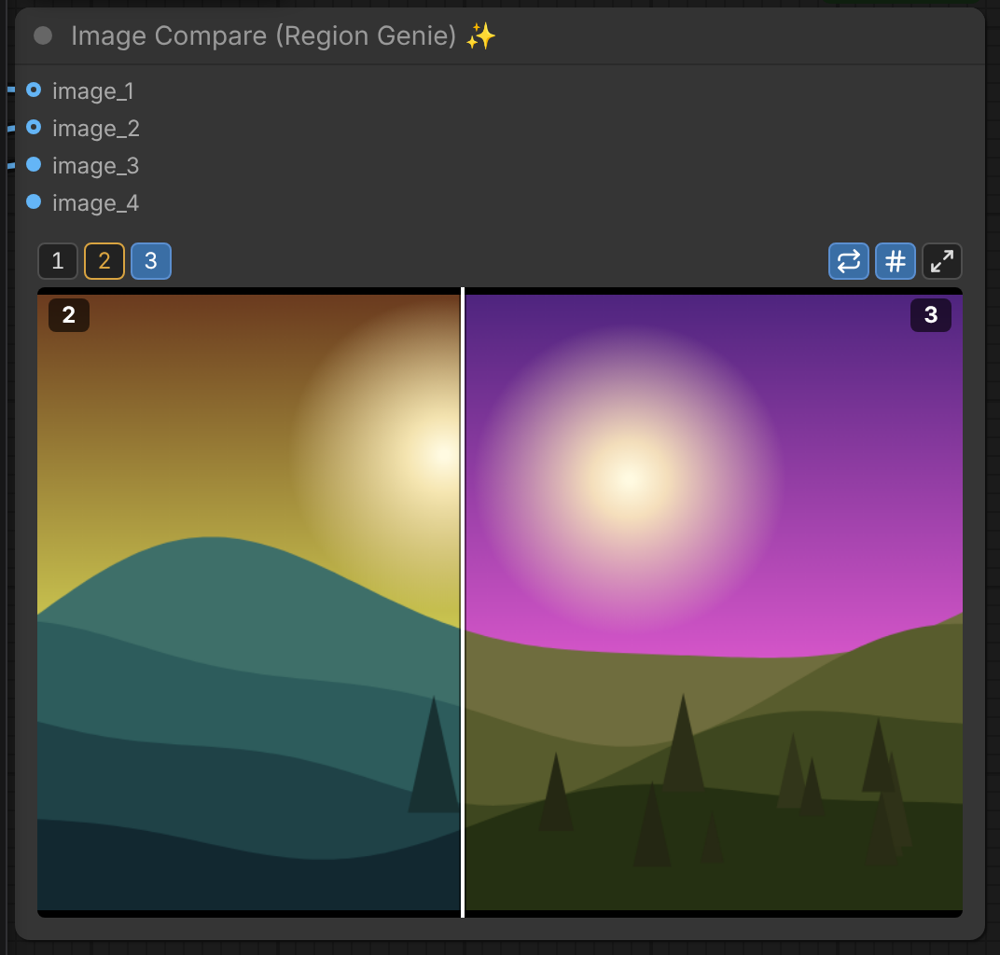

# Image Compare (Region Genie)

Shows two or more images in one node, to compare them with a slider or by flipping between them with the keys.

## Connecting images

- The node starts with `image_1` and `image_2`. When the last input gets a cable, a free one is added after it, so any number of images can be connected.
- **A batch counts per image:** a batch of 4 on one input is 4 pictures.
- The pictures are numbered in input order: all of `image_1`, then all of `image_2`, and so on. The numbers are the row of buttons above the picture.
- Like ComfyUI's own preview, the node shows the pictures of the last run.

## Comparing

- **The chosen picture** is the lit number. After every run it is the last picture (the highest number), so the newest result shows: four pictures read 3 | 4, and a later run that brings three reads 2 | 3.
- **Pointer on the picture:** the picture *before* the chosen one is left of the pointer, the chosen one right of it. The number of the left picture has an outline in the switched-on color.
- **Pointer off the picture:** the chosen picture shows whole.

## Keys

They act while the pointer is over the node (the picture or the row of numbers).

| Key | What it does | Can be changed |
|---|---|---|
| 1 to 9, on the number row or the numpad | Chooses that picture | No |
| Left / Right arrow | The picture before / after, around the ends | Yes |

Change the two stepping keys in the pack's shortcut list (**Settings > Region Genie > Shortcuts > Edit…**), in its section *Image Compare node*. They may be keys the Region Genie node's editor also uses: each node only takes its keys while the pointer is over it.

Flipping in place: rest the pointer on the row of numbers and press the keys. The chosen picture shows whole and changes in place, which shows small differences well.

## The two buttons

- **Around the corner** (on to start with): picture 1 has no picture before it, so the *last* picture is on its left. Off: picture 1 shows alone.
- **Number labels** (on to start with): the numbers in the picture's top corners, which say which picture is on which side.

Both are saved with the workflow.

## Two pictures

The usual before / after: picture 2 is chosen, so it reads **1 | 2**. Press 1 and the sides swap (**2 | 1**), because picture 1's left neighbour is the last picture. With *around the corner* off, picture 1 shows alone and picture 2 stays 1 | 2.

## Hiding a picture

**Right-click a number** to hide that picture from the comparison; right-click it again, or click it, to show it again.

- The pictures next to a hidden one are compared with each other. With five pictures connected, hide 3 and 4 to compare 2 and 5 directly, without changing any cable.
- A hidden picture keeps its number and is shown dimmed and struck through. Its number key does nothing, and the arrow keys step over it.
- Which pictures are hidden is saved with the workflow. The last shown picture can't be hidden.

## Notes

- Pictures of different sizes are each fitted into the same frame; the node does not resize them to match.
- Drag the node's corner to make the picture larger.
