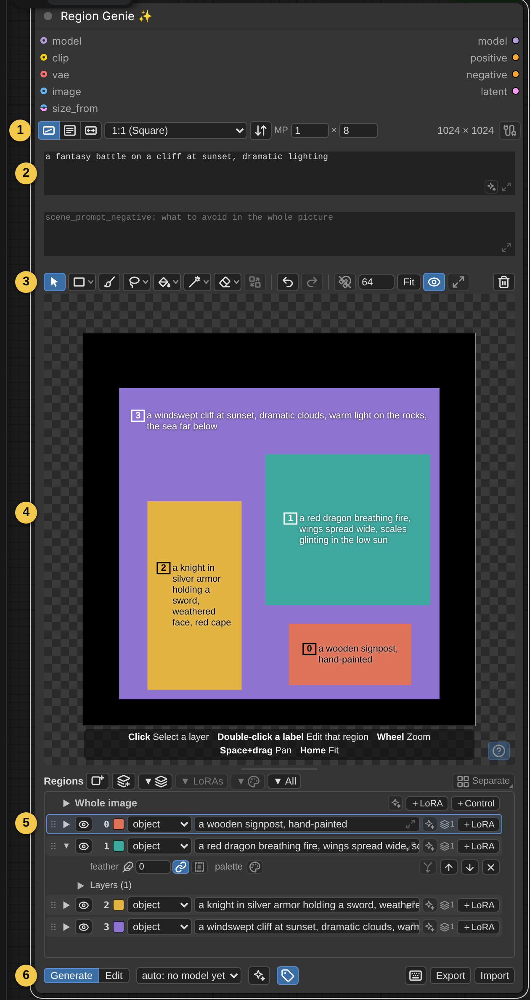
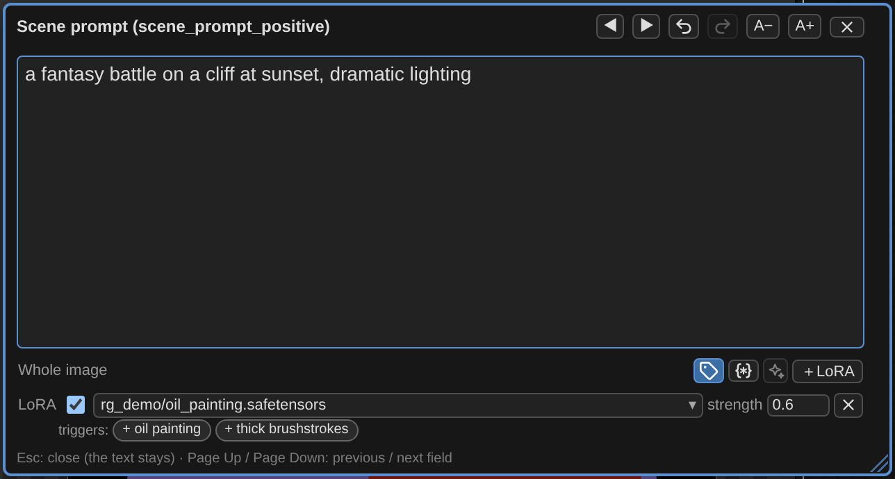
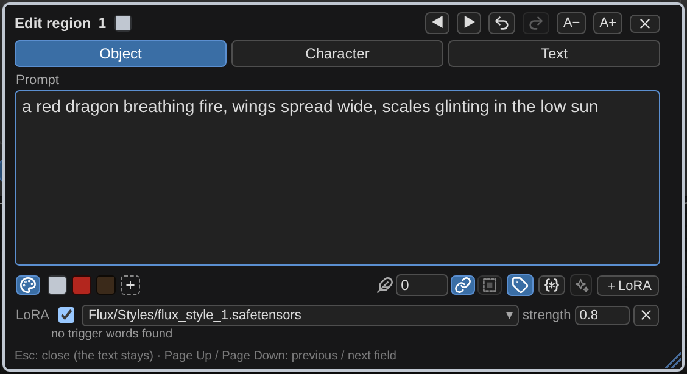
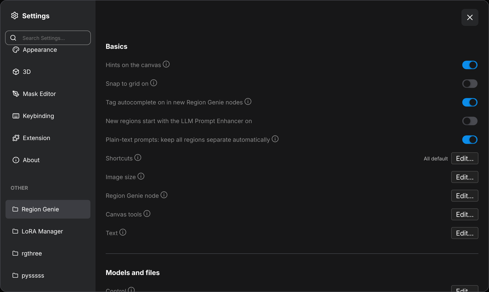
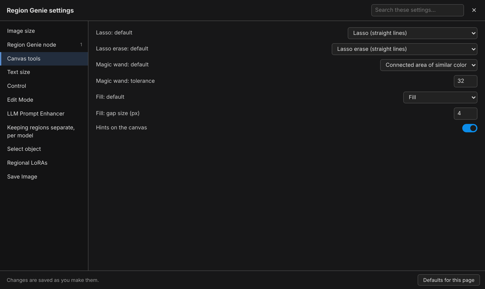
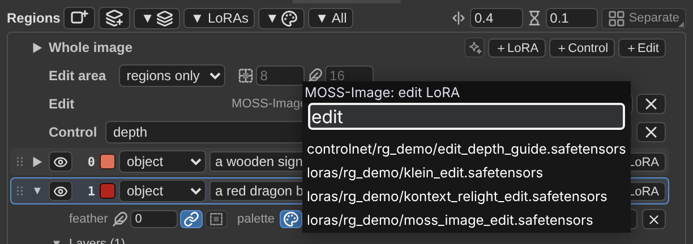

# Region Genie (the node)

Paint regions of any shape on the node's canvas, one flat color per region with its prompt next to it. The node gives the sampler a model, prompts and a latent that place each prompt in its region, and a color map, exact masks and layout boxes for other nodes.

1. **Sockets and image size:** what the node takes and gives, and the size of the picture.
2. **Scene prompts:** the whole picture, and what to avoid.
3. **Tools:** select, shapes, brush, lasso, fill, magic wand, eraser, arrange; undo, snap, labels, the large editor.
4. **Canvas:** where you draw the regions.
5. **Region list:** one row per region with its prompt; open a row for its layers, LoRAs and colors.
6. **Bottom bar:** Generate / Edit, the model, LLM settings, shortcuts, Export / Import.

New here? The [quick start](../README.md#-quick-start) in the README gets a first picture made. This page is the reference: use the list below to jump to what you need.

**On this page**

- [Finding your way](#finding-your-way)
  - [Shortcuts](#shortcuts)
  - [Right-click menu](#right-click-menu)
  - [Node size and the large editor](#node-size-and-the-large-editor)
  - [After a run](#after-a-run)
- [Image size](#image-size)
  - [What decides the size](#what-decides-the-size)
  - [Inputs and outputs shown](#inputs-and-outputs-shown)
- [Regions](#regions)
  - [Opening a region](#opening-a-region)
  - [Feather](#feather)
  - [Colors and the color palette](#colors-and-the-color-palette)
  - [LoRAs](#loras)
- [Layers](#layers)
- [Tools](#tools)
  - [Adding regions and layers](#adding-regions-and-layers)
  - [Select](#select)
  - [Shapes](#shapes)
  - [Brush and eraser](#brush-and-eraser)
  - [Lasso](#lasso)
  - [Fill and gradient fill](#fill-and-gradient-fill)
  - [Magic wand](#magic-wand)
  - [Select object (SAM 3.1)](#select-object-sam-31)
  - [Arrange: flip, align, grow / shrink](#arrange-flip-align-grow--shrink)
- [The canvas view](#the-canvas-view)
- [Working from an image](#working-from-an-image)
- [Text boxes and pop-up editors](#text-boxes-and-pop-up-editors)
- [Undo and redo](#undo-and-redo)
- [Export and import](#export-and-import)
- [The bottom bar](#the-bottom-bar)
- [Settings and model files](#settings-and-model-files)
- [Outputs](#outputs)
- [Prompt formats by model](#prompt-formats-by-model)
  - [MOSS-Image: layout or standard](#moss-image-layout-or-standard)
  - [Workflows from earlier versions](#workflows-from-earlier-versions)

## Finding your way

- **Without regions** the node is a plain text-to-image prompt node, so the same workflow serves pictures with and without regions.
  - `scene_prompt_positive` and `scene_prompt_negative` are the prompts; `positive`, `negative`, `latent` and `model` go to the sampler as always.
  - The size row sets the image size, and **＋LoRA** on *Whole image* adds LoRAs for the whole picture.
  - `prompt` is then your scene prompt as plain text (Ideogram 4: its caption JSON with no elements). Hiding every region (the eye buttons) does the same without deleting anything.
- **An empty canvas** shows three first steps: pick a shape and drag a box (your first region), type its prompt in the list under the canvas, connect and run.
- **The line along the canvas's bottom edge** shows the keys and gestures of the tool in use (for the Rectangle: drag, Shift for equal sides, Alt from the centre).
  - It fades while the pointer is on the canvas (so it never covers what you work on), comes back when the pointer leaves, and shows for a few seconds when you switch tools.
  - The small **?** button in the canvas's lower right corner hides or shows the hints with one click (the same switch as in Settings).
  - **Settings > Region Genie > Canvas tools > Hints on the canvas** turns it and the first steps off.
- **Tooltips:** point at any button, field or switch for what it does. A shortcut is shown as a key next to the text.
- **In-app help:** select the node and press **Node Info** in ComfyUI's toolbar (or the Info tab of the side panel) for a short guide with a numbered picture of the node. Every node of the pack has one.
- **Small buttons are easier to hit:** a click just above, below or beside a small button, a row's ▶ or its grip still counts (the area is at least 24 px tall).

### Shortcuts

- **Shortcuts** (V, R, B, L, F, W, Q, E, G, Ctrl+Z …) work while the pointer is anywhere over the editor: the tools, the canvas, the region list or the bottom bar.
  - A text field you are typing in keeps the keys.
  - **Press ?** (or the keyboard button in the bottom bar, left of Export) for a sheet with every key and mouse gesture. Esc, ? again or a click outside closes it.
- **Your own keys:** in that sheet, click a key and press the key or combination you want instead (Ctrl, Alt and Shift combinations, function keys, any letter or symbol).
  - Esc while it waits leaves the key as it is.
  - **+** next to a key adds a second key for the same thing, **✕** (shown while a key waits) removes a key, the round arrow on a changed row puts its default back, and **Reset all** puts every default back.
  - A key that another shortcut already uses is taken from that one, and the sheet says which. The buttons' tooltips, the hints on the canvas and the right-click menu show the keys you chose.
  - Mouse gestures and held keys (Shift for equal sides, the wheel, right-click …) are listed with a dashed outline and can't be changed.
  - Esc can't be given to something else by pressing it (it cancels), but the shortcuts that use it can be given another key.
  - The same sheet opens from **Settings > Region Genie > Shortcuts > Edit…**; the keys apply to every Region Genie node and are saved with ComfyUI's settings, not with the workflow.

### Right-click menu

- **Right-click on the canvas** opens a menu.
  - On a region (which becomes the active one): Edit prompt, Hide region, Move up / down in the list, Duplicate or Delete the layer under the pointer, Delete region.
  - Where regions overlap, the others under the pointer are listed under *Also here*.
  - On empty canvas: Add a region, Paste layer, Fit the image in view, Labels on / off, Snap to grid on / off, the large editor and the shortcut sheet.
  - Everything in it can be undone with Ctrl+Z like the buttons it stands for.

### Node size and the large editor

- **A new node** is 580 px wide and as tall as a square canvas needs.
  - In legacy node mode that is about 1146 px, with the sockets a new node shows.
  - In Nodes 2.0 ComfyUI shares the height between the scene prompt boxes and the editor, so the canvas starts wider than tall there.
  - Drag the node's corner to resize it, or use the large editor (the bar between the canvas and the list is described below).
- **The large editor** (the button with two arrows, right of the labels button in the tool bar; or **Alt+Enter** while the pointer is over the editor): the same editor in a window that fills the ComfyUI page.
  - The tools stay in their row above the canvas, which takes the left; on the right are the size row, the scene prompts, the region list (with room for many regions) and the bottom bar.
  - It is the node's own editor moved there, so every tool, pop-up, shortcut and Ctrl+Z works as on the node, and nothing has to be saved or applied.
  - Close it with the button again, **✕**, the key, or **Esc** with nothing selected: the editor is back in the node as you left it.
  - The scene prompt boxes in the window are the node's own fields mirrored (Esc leaves a box). While it is open the node shows a note with **Bring it back**; it also closes by itself when you switch to another workflow.
  - The key can be changed in the shortcut list (press **?**). Ctrl+Enter still queues the workflow from the window.
- **Canvas or list, more room:** drag the bar between the canvas and the region list to make the list taller or shorter. The bar lights up when you point at it.
  - The canvas takes the rest, and the node keeps its size.
  - Each node keeps its own split. Double-click the bar for the usual list height.

### After a run

- **After a run**, a button left of Export shows what the run reported (the text of the `region_info` output).
  - A **warning triangle** with a number: the run left notes (something was skipped, missing or not connected).
  - An **i in a circle**: it left none.
  - Click it to read the report under the canvas. Click again, ✕ or picking a tool closes it.
  - A run that ComfyUI answers from its cache (nothing changed) reports nothing new, so the button keeps the last report.

## Image size

The row at the top of the node sets the size of the picture. Three buttons on the left pick how the size is set, and the size it comes to shows on the right. Each way keeps its own settings, so switching back and forth loses nothing.

- **Aspect ratio** (like ComfyUI's **Resolution Selector**, with the same results): the aspect ratio, **MP** (megapixels, 0.1–16) and **×** (the multiple width and height are rounded to, 8–128).
  - The ⇅ button swaps width and height (e.g. 21:9 → 9:21).
- **Presets:** a list of sizes shared by every Region Genie node; ⇅ swaps width and height.
  - Switching to presets brings back the preset you picked there last time: each of the three ways keeps its own choice.
  - To get a size made with the aspect ratio or typed in into the list, switch to presets and open the dropdown. Under the presets it has **＋ Add 1000 × 760 (the manual size)** and the same for the aspect ratio size.
  - Picking one adds that size to the list and makes it this node's size. A size that is already in the list isn't offered.
  - The last entry, **Edit list…**, opens a small editor:
    - Change a size or give it a name.
    - ↑ ↓ to reorder, ✕ to remove.
    - A **＋ W × H** button for each size the other two ways are set to. It adds that size without changing the node's.
    - **Defaults** to put the starting list back (1024×1024, 1152×896, 896×1152, 1216×832, 832×1216, 1344×768, 768×1344, 1536×640, 640×1536).
  - The list is also in **Settings > Region Genie > Image size > Presets**.
- **Manual:** **W** and **H**, ⇅ to swap them, the link button to keep the ratio (changing one side changes the other), and **±**, the step size.
  - The step size is how far the arrows of W and H go per click (64 to start). Its own arrows go to the multiples of 8, and down to 1 at the lowest; or type any number.
  - A width or height you type can be any number.
- **Settings > Region Genie > Image size** sets how new nodes start (mode, aspect ratio, megapixels, multiple, manual width / height / step size).
- **Number fields** (here and everywhere in the pack) are as wide as their value: two digits at least, wider as you type more, so the arrows never cover a digit.

### What decides the size

- **size_from** takes an image or a latent and gives the node its size (it replaces the two inputs `size_from_image` and `size_from_latent`; workflows that used them load with their link on `size_from`).
- The optional **width** and **height** inputs (tick them in the sockets list) override the row, e.g. from a Resolution Selector or a Primitive.
  - `size_from` still comes first.
  - In Edit Mode only the pixel count counts (the source image sets the shape).
  - When something else decides the size, the row is dimmed and its size shows in blue, with the reason in its tooltip.
- The canvas follows the image size, including when the `width` / `height` inputs are connected to another node.
  - The `size_from` input (an image or a latent) overrides them. The size shown at the right end of the size row is always the canvas's size, whatever decided it.
  - These resize the canvas right away: a connected Load Image, a latent node with width/height widgets, or ComfyUI's **Resolution Selector** (connected straight to `width`/`height`, or feeding the latent node's width/height).
  - Anything else resizes it after a run.
- **Changing the size** keeps every layer where it is relative to the image centre and to the other layers. Layers scale only with the image's shorter side.
  - Making a wide image tall keeps two stacked halves touching. What no longer fits is cut off at the edges.
- Workflows saved before the size row open in **Manual** with their size; a link into their old width / height moves to the new inputs.

### Inputs and outputs shown

- The **sockets button** at the right end of the row (a cable) opens a checklist of the node's inputs and outputs: tick what the node should show.
  - A new node shows `model`, `clip`, `vae`, `image` and `size_from` as inputs, and `model`, `positive`, `negative` and `latent` as outputs.
  - Everything else is one tick away: `width` / `height`, `import_json`, and the outputs `prompt`, `color_map`, `masks`, `bboxes`, `elements`, `character_boxes`, `region_info`, `width`, `height`.
  - A connected socket always stays (its tick is greyed). `control_image` shows by itself while the node has a Control row.
  - **All outputs** and **Sampler only** tick or untick the outputs in one go.
  - Newly ticked outputs go to the end of the list, so the order is yours.
  - When sockets come or go, the node's **top** moves and its bottom edge stays, so the editor keeps its size and place.

## Regions

- **The region list** (under the canvas) is the output.
  - The number left of each swatch is the region's output index: the `index` to use in Mask Picker or BBoxes to Masks, and its position in every output. Regions without visible pixels show "–" and are left out, so the numbers below them shift.
  - Each region has a color, a type (object, character or text, plus the text to render; that field grows while you edit it too, Shift+Enter for a new line) and a prompt.
  - The list order is the output order and the stacking order: **drag a region by the grip** (the six dots at the start of its row) to another place in the list.
    - A line shows where it will land, and letting go outside the list changes nothing.
    - A click on the grip without dragging makes the region active, like a click in its prompt.
    - ↑ ↓ on the region's options line (see *Opening a region*) move the region one step at a time.
  - Its layers move with it (the top region is in front; holes keep their place). Click a region's swatch to change its color (display only). The prompt field expands while you edit it; Enter finishes.
  - The small **⤢** button in a prompt's (or text's) bottom-right corner opens the region's pop-up editor next to its row; double-click selects a word, as in any text field. Click a region to make it active: new shapes, paint and fills use it.
  - A layer turned into a hole (✂ on its row) cuts a black hole through the layers below it.
- **A region's row** holds what is used all the time: show / hide, its number, color, type, the prompt (which gets most of the row), the LLM button, the layer count and ＋LoRA.
  - In Edit Mode also keep / change, and with a Control row its Control switch.
- **Show / hide a region:** the eye button (open: shown, closed: hidden) before a region's number.
  - A hidden region isn't drawn and is left out of every output (masks, prompt, LoRAs, the color map, Edit Mode's mask), as if it had no pixels.
  - Its row is dimmed and its number shows "–".
  - Its layers keep their own show / hide settings, so showing it again brings it back exactly as it was.
  - Drawing into a hidden region (or adding a selection to it) shows it again.

### Opening a region

- **Opening a region:** each region's ▶ chevron opens it.
  - First comes its **options line**:
    - **feather** (the value, the chain that links it and the dashed square for edges on the image border).
    - **palette** (on / off).
    - Then on the right: merge its layers (two lines joining into one), ↑ ↓ move the region, and ✕ delete it with its layers (Ctrl+Z brings it back).
  - Under it are its subsections: **Layers**, **LoRAs** and **Color palette** (only the ones it has). Each subsection has its own ▶ and starts closed; closing the region hides all of them.
  - The *Whole image* row opens with a click anywhere on it (except its sparkle and ＋LoRA buttons) and shows its LoRAs, or a hint when it has none.
  - The ▼ buttons above the list (▼ + layers icon, ▼ LoRAs, ▼ + palette icon) open or close that subsection in every region at once (LoRAs includes *Whole image*), and "▼ All" opens or closes everything.
  - Adding a LoRA or turning a palette on opens its subsection; selecting a layer on the canvas opens its region's layers.

### Feather

- **Feather** (on the region's options line: open the region with ▶): softens the region's mask edges by that many pixels, in `masks` and for its LoRAs, like Mask Picker's feather (default 0).
  - The chain button links the value: all linked regions share one value; unlink a region to give it its own. The dashed-square button is that region's `feather_canvas_edges`: off (default) keeps edges on the image border solid, on fades them too.
  - Connect `model` (and `clip`) and use the `model` output for the sampler: see [LoRAs per region](regional-loras.md).

### Colors and the color palette

- **Colors** are picked with a built-in color picker like the one in Create Bounding Boxes (saturation/brightness square, hue bar, Hex / RGB / HSL fields); it works the same in legacy nodes and Nodes 2.0.
  - Changes show live; click outside, press Esc or Enter to close it. A whole pick is one undo step.
  - The copy button copies the color in the chosen format (`#4ecb8d`, `rgb(78, 203, 141)` or `hsl(150, 55%, 55%)`).
  - The paste button (or Ctrl+V while the picker has focus) reads a color in any of those formats, CSS color names, or three plain numbers.
  - If the browser blocks reading the clipboard, the picker asks you to press Ctrl+V instead.
- **Color palette** (the palette icon on the region's options line; off by default): turns on a row of up to 5 colors under the region, like MOSS-Image's `palette` and Ideogram's `color_palette`.
  - "+" adds a white swatch in its place ("+" moves right, or hides at 5 colors) and opens the color picker on it; closing the picker without changing it keeps the white swatch. Click a color to change it, right-click to remove it.
  - The region is then shown in its **first palette color** everywhere: on the canvas, in the list and in `color_map`.
  - When that color is the same as (or very close to) black or another region's color, it is lightened or darkened a little so every region stays distinguishable.
  - The palette goes into `elements` (`color_palette`), `bboxes` (`palette`), the MOSS JSON `prompt` (`palette`, exactly as MOSS-Image Layout Prompt writes it) and the Ideogram JSON `prompt`, and Import reads it back.
  - Turning the palette off keeps its colors for later. Removing the last color (right-click) turns the palette off again.

### LoRAs

- **LoRAs** (MOSS-Image, Krea 2, Ideogram 4, Flux, Anima, SDXL / SD1.5): "＋LoRA" on a region adds a LoRA that acts only inside that region; "＋LoRA" on *Whole image* adds one for the whole picture.
  - A whole-image LoRA is merged into the model exactly like a Load LoRA (model only) node placed before the `model` input, so it costs no time while sampling and works with any model.
  - Each LoRA row has on/off, the LoRA (ComfyUI's list menu, so Easy-Use / rgthree folder nesting works), strength and ✕.
  - Its **trigger words** are shown as chips. Click a chip to add it to the region's prompt (whole-image LoRAs: to `scene_prompt_positive`).
  - The words are read from the files model managers save next to the LoRA (`.cm-info.json` "TrainedWords", `.civitai.info`, LoRA Manager `.metadata.json`, A1111 `.json`, or the file's own metadata). The chip's tooltip names the file.
  - A ✓ chip is already in the prompt.

## Layers

- **Layers** are the things you draw.
  - Each layer row has:
    - The **grip**: a click selects the layer. Drag it above or below another layer, also another region's, or onto a region's row to put it on top of that region's layers.
    - The eye (show / hide).
    - **✂ hole**. On: the layer cuts its area out of every layer below it, so no region is there; black in `color_map`.
      - It stays listed under its region, with a striped swatch, and is drawn striped on the canvas.
      - ✂ again makes it paint its region again.
    - ↑ ↓ move within the region. Holes move one step through the whole stack, so they cut what is below them.
    - Duplicate (two sheets; Ctrl+D). The copy lands exactly on the original and is named "… copy", then "… copy (2)", "… copy (3)" …
      - Right-click it to duplicate into another region instead: the copy keeps its place and shape, takes that region's color and goes on top of its layers.
    - Merge down (an arrow onto a line).
    - Move to another region (two arrows, left and right).
    - Erase its contents (a backspace key).
    - Delete (a bin).
  - The merge button on a region's options line merges all of its visible layers.
  - **Ctrl+C / Ctrl+X / Ctrl+V** copy, cut and paste the selected layer (click the canvas first so it has the keyboard): a pasted layer lands on top of the active region's layers, in the same place (with no active region, back in its own region).
  - It also pastes into another Region Genie node. With no layer selected, Ctrl+C / Ctrl+V do ComfyUI's usual node copy and paste.
  - Selecting a layer on the canvas opens its region.
  - Only visible pixels inside the image reach `masks`, `bboxes` and `color_map`.

## Tools

The tools are the icons in the bar above the canvas. Point at one for its name and shortcut.

- **The tool buttons:** the ones with versions show the version in use, with a **▾** on their right: click the icon to use it, click ▾ (or right-click the button) for the list.
  - **Shape** lists the shapes, **Lasso** and **Fill** their versions, **Magic wand** also holds **Select object**, and **Eraser** also holds the three **Lasso erase** versions.
  - The keyboard shortcuts pick a tool from a list directly (R / O / T, L, F, W, Q, E, Shift+L) and the button follows.
  - Options of the tool in use (star points, corner radius, fill gap, wand tolerance, Select object's find field and ✓ / ✕) show in a small strip in the canvas's top-left corner, so the row of tools never changes width.
- **The strip on the canvas** (top left) holds the active tool's field: the star's points, the corner radius, the fill gap, the wand tolerance or Select object's *find all…*.
  - It folds to a small rounded square with the field's icon so it doesn't cover the canvas.
  - Point at it to open it. It stays open while you type in it, or while a selection waits for ✓ / ✕.
  - Click the icon to keep it open (click again to fold it).
- **Alt+click** with any painting tool (brush, lasso, fill, wand, select object, eraser) is an **eyedropper**: the region under the pointer becomes the active region.
- **Clear all** (the bin at the right end of the tool bar, red when you point at it) removes every layer and region. Ctrl+Z brings them back.
- The defaults of the tools with versions (lasso, lasso erase, magic wand, fill) and the wand tolerance and fill gap size are in **Settings > Region Genie > Canvas tools**.

### Adding regions and layers

- **Tools** (icons in the bar above the canvas; hover for names and shortcuts).
  - The add-region button (a box with a plus, in the list header) switches to the Rectangle tool, so you can draw the new region's box right away.
  - Its color is the next of the **region colors** that isn't on the canvas yet: calm, clearly different tones, purple first, then golden yellow, teal, coral, sky blue …
  - **Settings > Region Genie > Region Genie node > Region colors** sets your own list and order: click a color to change it, right-click to remove it, ＋ to add one, Defaults to put the built-in ones back.
  - When all are in use, the node picks one that looks different from the colors on the canvas. Regions already drawn keep their colors, and a layout loaded from boxes (Import, import_json) takes your colors too.
  - The add-layer button (stacked sheets with a plus) adds an empty layer on top of the active region's layers (brush, lasso and fill then paint into it); with no active region it does nothing.
  - A region's label sits at the centre of the pixels that region really shows.

### Select

- Select (V):
  - Click to select. Clicking anywhere outside the canvas hides the box and handles; the layer stays selected, so brush, lasso and fill still paint into it.
  - Drag to move.
  - Square handles resize. Shift keeps proportions. **Alt** resizes from the centre, so the opposite side moves the same amount the other way. Both can be held together.
  - The round handle rotates (Shift snaps to 15°).

### Shapes

- Shapes (the Shape button's ▾; its icon shows the shape it draws): Rectangle (R), Ellipse (O), Triangle (T), Rounded rectangle, Pentagon, Hexagon, Star and Heart.
  - Rounded rectangle: set the corner radius in % of the shorter side, in the strip on the canvas.
  - Star: set the number of points.
  - Drag a box to draw one (Shift for equal sides, Alt to draw from the centre out).

### Brush and eraser

- Brush (B) paints into the selected layer, or starts a new layer for the active region.
  - Its size slider sits on the left edge of the canvas while the brush or eraser is selected (drag the bar; [ ] and Alt+wheel work too).
  - **Shift+click** draws a straight line from where the last brush or eraser stroke ended.
- Eraser (E) and Lasso erase (Shift+L; in the Eraser button's ▾ list) work on the selected layer.

### Lasso

- Lasso (L): drag freehand, or click points one by one and close the loop by clicking the first point, double-clicking or pressing Enter.
  - Backspace removes the last point and Esc cancels.
  - **Spline mode:** pick "(spline)" in the Lasso button's ▾ list (Lasso erase: the Eraser button's list).
    - The outline becomes a smooth curve through the clicked points.
    - A freehand path is smoothed (hand jitter removed) before the curve goes through it.
  - The choice stays for the rest of the session, for every Region Genie node on the page. Pick the plain lasso in the same list to go back.
  - **Magnetic mode** (third choice): the outline follows the edges in the image under the canvas (the `image` input); dragging pulls the path onto the nearest strong edge, and each click adds a segment that runs along edges to the clicked point.
  - Without an image it draws a plain lasso. Which one each button starts as is set in **Settings > Region Genie > Canvas tools** (*Lasso: default*, *Lasso erase: default*).

### Fill and gradient fill

- Fill (F) fills the clicked area (enclosed blank space, or one color) with the active region.
  - Its ▾ list has **Fill, closing small gaps**: openings narrower than about twice the gap size (the field in the strip on the canvas, 4 px by default) count as closed, so the fill stays inside an outline that has small breaks.
  - **Gradient fill** (two more entries in the Fill button's ▾ list): the same area, but the active region **fades** across it instead of filling it evenly.
  - *Linear:* drag a line; the region is at full strength where the line starts and fades to nothing where it ends. *Radial:* drag outward from a point; full strength at the point, nothing at the distance you drag.
  - A white line (and circle) shows the drag; a plain click fills nothing.
  - The fill becomes a layer of its own ("Gradient …") that you can move, scale, turn, flip, hide or delete like any layer; the gradient follows it.
  - On the canvas the region's color fades out.
  - In the outputs, the region's **mask** carries the fade, so regional LoRAs, keeping regions separate and Mask Picker get a soft transition.
  - In `color_map`, the boxes and the layout prompt, the area counts as that region where it is at least half strength.
  - Merging the layer into another makes it an even fill again; a hole (✂) is always even.

### Magic wand

- **Magic wand** (W) works on the image under the canvas: a click adds the connected area of similar color to the active region (as a pixel layer, or into the selected plain layer of that region).
  - Its ▾ list has **all similar colors** (every matching pixel in the image, connected or not) and Select object.
  - The field in the strip on the canvas is the tolerance (0-255 per color channel, 32 by default).
  - It needs an image on `image`: a directly connected Load Image, or any image after a run.

### Select object (SAM 3.1)

- **Select object** (Q, or the Magic wand button's ▾ list) uses **SAM 3.1** (ComfyUI's native support) on the image under the canvas.
  - **Click** the object (a green point), **Ctrl+click** a spot the selection covers but shouldn't (a red point: that part is taken out), or **drag a box** around it; each change updates the selection, shown tinted on the canvas.
  - Backspace removes the last point, **Enter** (or the ✓ button next to the find field in the strip on the canvas) adds the selection, and Esc (or ✕) discards it.
  - **Where it goes:** into the active region, in Generate and Edit mode alike: into its selected layer, or a new layer if none of its layers is selected. A region can be built from several layers and still counts as one mask.
  - **Shift+click** (or Shift+drag) adds the selection made so far and starts the next one. Switching to another tool also adds a finished selection instead of throwing it away.
  - **Find all:** type what to select in the field next to the button (e.g. `person`, or `red car, dog` for several things) and press Enter: every match is selected (drag a box first to search only inside it).
  - Ctrl+click a match to leave it out (again to bring it back). Enter adds them all to the active region, **Shift+Enter** makes each its own new region with the text as its prompt.
- Needs `sam3.1_multiplex_fp16.safetensors` ([download](https://huggingface.co/Comfy-Org/sam3.1/resolve/main/checkpoints/sam3.1_multiplex_fp16.safetensors), about 1.7 GB) in `ComfyUI/models/checkpoints`.
- Also needs an image on `image` (a directly connected Load Image, or any image after a run).
- Problems (the model file is missing, the server didn't answer) show in a red bar under the canvas. It stays until you close it (✕), pick another tool or switch between Generate and Edit.
  - Its text can be selected and copied (Ctrl+C or right-click), the download link opens in a new tab, and **Copy link** copies it.
- The first selection loads the model (a few seconds); after that, the image is analysed once and every further click on it is quick.
- **Settings > Region Genie > Select object:** the model file; **After a selection**: keep the model loaded (default) or unload it after each selection; and the *Find all* confidence.
- Kept loaded, the model is one of ComfyUI's managed models: when a workflow needs the VRAM, ComfyUI moves it to system RAM, and the next click brings it back.
- While a workflow is running, Select object waits for it to finish and then continues by itself.

### Arrange: flip, align, grow / shrink

- **Arrange** (the button after the tools, enabled with a layer selected) opens a small panel: **Flip**, **Align** and **Edge**. All undoable.
- **Flip** horizontally / vertically: the layer becomes its mirror picture on the image (left-right, or upside down) and stays where it is, also when it is turned or stretched.
  - A shape stays that shape (a rectangle turned 30° is then turned the other way; a triangle flipped upside down points down).
- **Align** to the left, centre, right, top, middle or bottom of the image, or centre it: by the layer's own pixels, so a turned ellipse really touches the edge.
- **Edge**: grow or shrink the layer by a number of pixels on every side.
  - A shape with nothing painted on it stays that shape and can still be resized and turned afterwards. Its sides move by that many pixels and its corners stay corners (a rectangle stays a rectangle, a star a star).
  - A rounded rectangle's corners get a radius that much larger or smaller; a heart grows by its box.
  - Anything painted (brush strokes, lasso outlines, fills, selections, and a shape that was painted or erased on) becomes pixels. Every point of its edge moves by that many pixels, measured straight, so round ends stay round.
  - Corners of a shape and of lasso outlines stay pointed when growing, unless something was erased from the layer (then they are rounded, so nothing erased comes back).
  - What is grown past the image's edge is kept (it just isn't seen or used), so shrinking again takes it back from every side and the layer ends up where it started.
  - A layer too small to shrink that far is left as it is, with a message.

## The canvas view

- **Snap** (the magnet button, highlighted when on; slashed magnet when off; or G) snaps drawing, moving and resizing to a grid set in image pixels. Arrow keys nudge (Shift ×10).
- **View:** the image sits in a checkered margin.
  - Shapes can hang off the edge, and only the part inside the image is output.
  - The mouse wheel zooms, middle-drag or Space+drag pans, Fit (Home) resets the view, and Alt+wheel or `[` `]` changes brush size.
  - This is the same in Nodes 2.0: the wheel zooms the canvas, not the graph, while the pointer is over it.
- **Labels** (the eye button, on by default): each region's output index and prompt are written **inside the region**, as much of the prompt as fits.
  - A small filled **person** before the prompt marks a *character* region, and in Edit Mode a filled **lock** marks a region kept as it is; both are in the text's own color.
  - In Edit Mode the label of a kept region lies on a dark plate (the region is only an outline over the picture it keeps, so the text would otherwise sit on the picture itself).
  - The text goes into the largest upright rectangle that lies inside the part of the region you can see (so it never runs over a neighbour or a region drawn on top), with a margin, centred; zooming in gives it more room.
  - It is black or white, whichever reads better on the region's color; while an image shows through the regions, or a control map is on the canvas, it gets a dark plate.
  - A region too small for a line of text keeps a compact label next to it (its index and up to three lines). Clicking and dragging on the text still acts on the layer under it.
  - Double-click the text to open the **region editor**, all live:
    - Object / Character / Text buttons (the current type is highlighted).
    - A multi-line Prompt, and a multi-line Text for text regions.
    - The region's feather, palette and LoRAs (with trigger-word chips).
  - Enter or a click outside closes it, Shift+Enter adds a line, Esc closes it and undoes the text you were editing. Each change is one undo step.

## Working from an image

- **Image mode** (a small strip in the canvas's top right corner, only while an image is connected and not in Edit Mode): two buttons, **backdrop** (trace over) and **color map**. With color map, a field next to them sets the **min region pixels**.
- **`image` input, "backdrop (trace over)":** the image is shown under the canvas to trace over.
  - The **image opacity** slider on the canvas's right edge sets how strongly. It is only shown with an image connected; drag it or use the mouse wheel over it.
  - A directly connected Load Image shows right away; anything else shows after a run.
- **`image` input, "use as color map":** the image's flat colors become regions under all layers, and they appear in the region list after a run so you can give them prompts.
- **min region pixels** and **what import_json does when the canvas isn't empty** are settings for all nodes: **Settings > Region Genie > Region Genie node** (*Color map: min region pixels*, *import_json when the canvas isn't empty*).
  - The node sends them with each run.
  - The old `min_region_pixels` and `import_mode` values inside workflows are only used when a prompt is queued without the editor (e.g. through the API).

## Text boxes and pop-up editors

Every text field of the node opens in a **pop-up editor**: a large text box that floats over the page. Open one with the **⤢** button in the field's corner, or by double-clicking a region's label on the canvas.

*The pop-up of `scene_prompt_positive`.*

*The pop-up of a region.*

| Where | Control | What it does |
|---|---|---|
| Title bar | ◀ ▶ | The previous / next text field, in the same place and size (Page Up / Page Down) |
| | Undo / Redo | This field's own text steps (Ctrl+Z, Ctrl+Shift+Z / Ctrl+Y) |
| | A− / A+ | Text size of the box you're typing in |
| | Close | Closes the pop-up (Esc); the text stays |
| | The bar itself | Drag to move the pop-up; double-click to put it back next to its field |
| Region only | The color square | The region's color |
| | Object / Character / Text | The region's type (Text adds a box for the text to render) |
| | Color palette (left of the bottom row) | On / off, the colors, **+** |
| | Feather | The value, the chain that links it to other regions, and edges on the image border |
| | Kept / changed | Edit Mode only |
| Bottom row | Tag autocomplete | On / off |
| | Wildcards | The wildcard list (ComfyUI Impact Pack) |
| | LLM Prompt Enhancer | On / off for this field (not on `scene_prompt_negative`) |
| | ＋LoRA | A LoRA for this region; for the whole image on `scene_prompt_positive`. Each LoRA row: on / off, file, strength, remove, trigger-word chips |
| Corner | ◢ grip | Drag to resize; double-click for the default size |

The details:

- **`scene_prompt_background`** (under the two scene prompts; Ideogram 4 only): the background or setting behind the regions (ground, floor, sky, room ...).
  - It is the `background` of the Ideogram JSON prompt, which Ideogram 4 requires.
  - It shows only while the model (bottom bar) is Ideogram 4, picked or found; other models don't use it.
  - Its text is kept while it is hidden.
- **Scene prompts in a pop-up:** the **⤢** button in the bottom-right corner of `scene_prompt_positive`, `scene_prompt_negative` or `scene_prompt_background` opens it in a larger pop-up editor.
  - Enter: a new line. Esc or the close button: close, the text stays.
  - The positive one also has the LLM Prompt Enhancer button and the whole-image LoRAs (add, strengths, trigger-word chips).
  - The region pop-up editor (double-click a region's label on the canvas, or ⤢ on its prompt in the region list) has the LLM Prompt Enhancer button too.
- **The pop-up editors** open large, next to the field, and float over the page.
  - Drag the title bar to move one anywhere on the screen. Double-click the title bar to put it back next to the field.
  - Drag the ◢ grip in the bottom-right corner to resize it (remembered for every Region Genie node). Double-click the grip for the default size.
  - **A− / A+** in the header make the text of the box you're typing in smaller or larger; the pop-up keeps its size.
  - A pop-up stays open while you work elsewhere (clicks on the canvas or the graph don't close it) until **Esc**, the **close button** in its top-right corner, opening another pop-up, or switching to another workflow tab (or into a subgraph).
  - **Enter** starts a new line, as in any text box.
- **A pop-up always keeps its text.** Neither Esc nor the close button takes anything back; that is what the **Undo / Redo** buttons in the header are for.
  - The buttons are between ◀ / ▶ and A− / A+. Ctrl+Z and Ctrl+Shift+Z / Ctrl+Y also work while you type, or your own keys for Undo / Redo from the shortcut list.
  - They act on the text box you're typing in, one step per word or per pause in typing, and a text set by something else (the LLM, a wildcard, a LoRA's trigger words, "use the filled text") is a step too.
  - The steps of each field are kept while the workflow is open: close the pop-up, open it again later, and Undo still goes back, all the way to the text the field had when you first opened it.
  - Outside a pop-up, the same keys undo the editor's last step as before (a whole prompt edit is one step there).
- **The bottom row of a pop-up.**
  - In a region's pop-up, the color palette is on the left: its on / off button, the colors and **+**.
  - Everything else is on the right of the same row: kept / changed (Edit Mode), feather, the tag autocomplete switch, the wildcard list (when ComfyUI Impact Pack is installed), the LLM Prompt Enhancer button and ＋LoRA.
  - The scene prompts' pop-ups have the same right-hand group (the LLM button and ＋LoRA on `scene_prompt_positive` only).
- **Esc closes what is on top first:** with a list or menu open over a pop-up, Esc closes that; the next Esc closes the pop-up.
- **The pop-up button of a text box (⤢)** sits in the box's bottom-right corner, left of the scroll bar when the box has one, and in the middle of a region's one-line prompt box.
  - Text stops before it, so nothing you type is hidden under the button or the scroll bar.
- **`scene_prompt_positive` shows its LLM Prompt Enhancer:** the sparkles button is also in the box's corner, left of ⤢.
  - It is dimmed when off, lit when on. A click switches it, exactly like the button in the *Whole image* row.
  - The box has a blue outline while the enhancer is on.
  - `scene_prompt_negative` has no enhancer.
- **◀ / ▶** in a pop-up's header step to the previous / next text field of the node without closing it.
  - The order: `scene_prompt_positive`, `scene_prompt_negative`, `scene_prompt_background` (when shown), then each region's prompt in list order, wrapping around at both ends.
  - The next field opens in the same place and size. They sit in the header left of Undo / Redo and A− / A+, always in the same place, so they don't move while you step.
  - **Ctrl+Up / Ctrl+Down** raise or lower the strength of the word the cursor is in, or of the words you selected: `tag` becomes `(tag:1.05)`, `(tag:0.95)` and so on.
    - This is ComfyUI's own feature, and it works in every text box of the pack: on the node, in the list, in the pop-up editors and in the large editor.
    - A strength of 1 removes the brackets again. The step (0.05) is ComfyUI's setting *Ctrl+up/down precision*.
    - Each change is one step of the field's Undo.
  - **Page Up / Page Down** do the same while you type; other keys can be set in the shortcut list (press **?** over a Region Genie node, or **Settings > Region Genie > Shortcuts**).
- **Text size** (Settings > Region Genie > Text size): one size per kind of field (scene prompts, region prompts, text to render), set separately for the pop-up editors and for the node's own fields (0 = as before).

## Undo and redo

- **Undo and redo:** Ctrl+Z and Ctrl+Shift+Z / Ctrl+Y work on the editor, not on the ComfyUI graph, while you're using the editor.
- **Text is part of Undo.** Every visit to a text box (click in, type, click out) is one step of the editor's Undo, in order with drawing and everything else.
  - This covers the scene prompts, a region's prompt and its text to render, on the node, in the large editor and in the pop-up editors.
  - So after typing a prompt, clicking out and drawing a shape, Undo takes back the shape and then the whole prompt edit.
  - A scene prompt changed by something else (a LoRA's trigger words, "use the filled text", ComfyUI's own parameters panel) is a step too.
  - The tool bar's Undo button is ready as soon as you have typed something, also while the cursor is still in the box.
- **While the cursor is in a text box**, Ctrl+Z and Ctrl+Shift+Z / Ctrl+Y (or your own keys for Undo / Redo) go back and forth through that box's own text, about a word at a time.
  - This works in every prompt box of the node, also after you clicked out, did something else and came back.
  - It is the same history the box's pop-up editor shows with its Undo / Redo buttons.
- **Typing isn't interrupted.** When the editor updates the region list by itself (after a run, or when it re-checks its settings), it waits while you are typing in a prompt or a number field of the list.
  - It updates when you leave the field, so a number you haven't entered yet is not lost and the cursor stays where it is.
- **None of this is saved.** The steps are kept in memory while the workflow is open in the browser. They are not written to the workflow or to any file, and loading a workflow (or reloading the page) starts with an empty history.

## Export and import

- **Export / Import** (bottom right of the node) save the layout (regions, LoRAs, palettes, feather, layers, the scene prompts and size) as a `.json` file and load it back.
  - Import also reads MOSS-Image layout JSON, Ideogram caption JSON / elements and bboxes from other nodes. Each box becomes a rectangle layer, first box on top.
  - Imports are undoable.
- **import_json** (an input: tick it in the sockets list of the size row) loads a layout when the workflow runs, in any format Import reads (e.g. paste a saved file into a String node).
  - Each new import_json is used once, so edits you make afterwards are kept.
  - An empty canvas is always filled. Otherwise the setting *import_json when the canvas isn't empty* (Settings > Region Genie) decides:
    - *ask before replacing* keeps the canvas for that run and shows **Replace canvas / Keep canvas** on the node.
    - *always replace* loads it right away.
  - Clear all forgets the last import, so the same import_json fills the canvas again on the next run.
- Canvases saved with earlier versions are converted automatically.

## The bottom bar

- **Bottom bar of the node:**
  - **Generate / Edit** (see [Edit Mode](edit-mode.md)). In Edit, a dropdown next to it: regions only / whole image, see its tooltip.
  - The **model**. It sets the format of `prompt` and `positive` (see *Which format `prompt` uses*), and the LoRAs Control and Edit Mode add (see [The model](control.md) under Control).
    - With MOSS-Image, the **layout / standard** switch next to it.
  - The **LLM Settings** sparkle.
  - The **tag** autocomplete button.
  - The **wildcard seed** (with Impact Pack, see [Wildcards](wildcards.md)).
  - Export / Import on the right.

## Settings and model files

**Where the settings are.** ComfyUI's **Settings > Region Genie** is a short list in three sections:

- **Basics:** the switches used most, **Shortcuts**, and the pages *Region Genie node*, *Image size*, *Canvas tools* and *Text size*.
  - The switches: hints on the canvas, snap to grid, tag autocomplete in new nodes, new regions start with the LLM on, keep all regions separate automatically.
- **Models and files:** the pages *Control*, *Edit Mode*, *LLM Prompt Enhancer*, *Keeping regions separate, per model* and *Select object*, then **Browse… for model files** and **Check model files**.
- **Other nodes:** the pages *Regional LoRAs* and *Save Image*.

A page row's **Edit…** opens the **Region Genie settings** window on that page. It covers ComfyUI's Settings while it is open:

- Every page is listed on the left; a number next to a page says how many of its settings differ from their defaults (the row in the tab says the same: "3 changed").
- Changes are saved as you make them.
- **Search these settings…** (top right) lists matching settings from every page.
- **Defaults for this page** puts that page back to its defaults; it asks for a second click first. Model files, region colors and LLM presets have their own reset or "None" and aren't touched by it.
- **Esc** or **✕** goes back to ComfyUI's Settings. With a menu or the search open, Esc closes that first.
- ComfyUI's own **Search Settings** finds a page by the name of any setting on it: searching for "WebP quality" shows the *Save Image* row.

So "Settings > Region Genie > Edit Mode" in a tooltip or in this manual means: the *Edit Mode* row, **Edit…**.

- **Settings > Region Genie** (ComfyUI's Settings) holds the defaults for new nodes. Nodes already in a workflow keep their own values. The defaults:
  - Tag autocomplete, what the LLM sees, whether new regions start with the LLM on.
  - The Region Genie node's image size (mode, aspect ratio, megapixels, multiple, manual width / height / step size; the presets list is shared by every node).
  - image_mode, feather, separation / until, keep all regions separate, share the background, snap and grid size.
  - Regional LoRAs' feather, lora_masking, region_separation, separation_until, separate_all_regions and share_background.
- Some settings apply to every node at its next run instead:
  - **Plain-text prompts: keep all regions separate automatically** (on by default) and one per model, see *Which format `prompt` uses*.
    - The per-model ones (MOSS-Image in standard mode and Edit Mode, Krea 2, Flux, Flux 3, Anima, SDXL / SD1.5): as set for all models / on / off.
  - The **Edit Mode** page (see [Edit Mode](edit-mode.md)).
  - **Canvas tools** (which version the lasso, lasso erase, magic wand and fill buttons start as, the wand tolerance and the fill gap size).
  - **min region pixels** and **import_json when the canvas isn't empty**.
  - **LLM cache** (see [LLM Prompt Enhancer](llm-prompt-enhancer.md)).
- **Model files** (in Settings: control LoRAs, ControlNets, Anima LLLite patches, Depth Anything 3, edit LoRAs, the Select object model; on the node: the Edit rows; in the LLM settings: the LLM and its LoRAs) are fields showing the file's name.
  - A click opens **ComfyUI's classic menu**, in both legacy mode and Nodes 2.0:
    - The control and edit files open on ComfyUI's model folders (📁 controlnet, 📁 loras, 📁 model_patches, 📁 geometry_estimation). A file from another folder than the setting's own is saved with its folder.
    - Select object opens on `checkpoints`.
    - The LLM opens on `text_encoders`.
  - With **rgthree-comfy**'s *Auto Nest Subdirectories in Menus* on, the menu shows subfolders as folders. Typing searches every folder and subfolder at once (the matches with their paths).

    

  - The list is read when the menu opens, so the Settings tab stays fast with any number of files (checked with 10 000 LoRAs). A name in red isn't in ComfyUI's model folders (moved, renamed or deleted, or added since ComfyUI started: press R).
  - **Settings > Region Genie > Browse… for model files** (off by default) adds a **folder button (Browse…)** to each field: it opens a browser of the ComfyUI machine's folders and drives (it starts in the setting's own folder).
  - A file picked inside one of ComfyUI's model folders is saved by its usual name.
  - A file anywhere else (e.g. Stability Matrix's shared `Models` folder) is saved by its full path and loaded from there.
  - Files picked by full path keep working with the switch off.
  - **Check model files** (Settings > Region Genie) looks up every file set in these Settings and in the LLM presets, and lists the ones that can't be found (moved, renamed or deleted).

## Outputs

| Output | Connect to |
|---|---|
| `color_map` | MOSS-Image Color/Depth Control `color_map` |
| `masks` | Exact region masks, in region order → Mask Picker (pick one for a regional LoRA) |
| `bboxes` | MOSS-Image Prompt Builder KJ `bboxes` (boxes only), Create Bounding Boxes `bboxes` (prompts included), BBoxes to Masks |
| `elements` + `character_boxes` | MOSS-Image Layout Prompt `element` and `character_boxes`; `elements` also works with Create Bounding Boxes and BBoxes to Masks |
| `prompt` | The prompt as text, in the format the model takes (see *Which format `prompt` uses*). **MOSS JSON**: straight into the MOSS text encoder as the layout prompt, or MOSS-Image Prompt Builder KJ `import_json`. **Ideogram JSON**: Ideogram 4's caption JSON, straight into the Ideogram 4 text encoder, or (Deno) Ideogram Director `import_json`; written as Ideogram's JSON prompting guide sets out: `high_level_description` (`scene_prompt_positive`; made from the region prompts when that is empty), then `compositional_deconstruction` with `background` (`scene_prompt_background`) and one element per region (`type` obj/text, `bbox` [y_min, x_min, y_max, x_max] on 0–1000, `text`, `desc`, up to 5 `color_palette` colors as `#RRGGBB`); with an Ideogram 4 model, `region_info` adds Ideogram's own tips (empty background, more than 5 elements, a scene over 50 words, text over 7 words). **text**: `scene_prompt_positive`, then each region's prompt as its own sentence, for Krea 2, Flux, Anima, SDXL / SD1.5 and other models without a layout format. |
| `model` | The connected model with the regions' LoRAs (see [LoRAs per region](regional-loras.md)) → the sampler's model |
| `latent` | → the sampler's `latent_image`. Generate: an empty latent of the canvas size, in the connected model's format (or the vae's; SD's without either), so no Empty Latent node is needed. Edit: the source image encoded with `vae`, with a mask of the regions unless the dropdown next to Edit is on *whole image* (see [Edit Mode](edit-mode.md)). |
| `positive` | `prompt` encoded with the connected clip → the sampler's positive |
| `negative` | `scene_prompt_negative` encoded with the connected clip (like CLIP Text Encode) → the sampler's negative |
| `region_info` | Text list of the regions, and which prompt format was used and why |
| `width`, `height` | The layout node's width/height. Pixel boxes need the same canvas size on both sides. |

A region's box covers all of its visible pixels, across all of its layers; give two objects separate regions if you want separate boxes.
Regions with no visible pixels are skipped in every output, so index *n* is the same region in `masks`, `bboxes`, `elements` and `prompt`.
BBoxes to Masks makes rectangles from the boxes; use this node's `masks` output for the exact painted shapes.

## Prompt formats by model

**Which format `prompt` uses:** the **model** dropdown in the node's bottom bar. A model picked there sets it (MOSS-Image: MOSS JSON, Ideogram 4: Ideogram JSON, the others: text). With *auto* (default) the connected `model` decides; without one, the text encoder on `clip`; without either, the text encoder that `prompt` is connected to (the node follows the link to a text encode node and up its `clip` input to the loader: CLIP Loader's type, Dual/Triple CLIP Loader and checkpoints mean text); MOSS JSON when none of them says. The dropdown's tooltip shows the format the last run used, and `region_info` says why. `positive` always encodes `prompt`.

| Model | `prompt` format | Regions placed by |
|---|---|---|
| MOSS-Image (or unknown) | MOSS JSON (standard mode, or no regions: text) | the boxes in the layout prompt |
| Ideogram 4 | Ideogram JSON | the boxes in the caption JSON |
| Krea 2, Flux.1, Flux.2 / Klein, Flux 3, Anima, SDXL (and SDXL-based models such as Illustrious-XL and NoobAI-XL), SD1.5 | text | attention only: **Keep all regions separate** (the **Separate** button, see [Regional LoRAs](regional-loras.md#loras-per-region-the-region-genie-nodes-model-output)) ties each region's sentence to its region. These models have no layout format, so it turns on by itself when the model and `clip` are connected and at least one region has a prompt; the switch then shows as on after the run. Click the lit switch to turn it off for that node, or turn it off for all of them or for one model in **Settings > Region Genie** (*keep all regions separate automatically*). |

Flux 3 encodes its text before sampling, so its text layers are outside the regional LoRAs' reach: there a LoRA acts on its region's image and on its caption inside the joint layers only. SDXL / SD1.5 regions act at every UNet resolution (each mask is scaled down to 1/2, 1/4 and 1/8).

### MOSS-Image: layout or standard

MOSS-Image takes its layout JSON (each region's box) or a plain text prompt. The switch next to the model dropdown (shown while the model is MOSS-Image) picks one: **layout** (default, boxes in a frame) or **standard** (lines of text: the regions become sentences; masks and regional LoRAs still apply). With no region drawn, every region hidden with its eye, or only holes left, the run uses standard by itself: there are no boxes to lay out; the switch then shows the standard icon (its tooltip says why), and layout comes back by itself when a region is drawn or shown. Clicking the switch then does nothing (there is nothing to choose). A **standard** choice made while there are regions lasts until the canvas has been empty: the first region drawn, shown again or imported after that brings layout back, so a node never stays in standard unnoticed. A workflow saved in standard mode loads in standard mode. Edit Mode always sends MOSS-Image a plain instruction (its edit LoRA takes one), so the switch shows standard there too. With plain text, MOSS-Image places the regions like the other plain-text models: **keep all regions separate** turns on by itself when a region has a prompt (Settings > Region Genie > *MOSS-Image (standard mode, Edit Mode): keep all regions separate automatically*, or the setting for all plain-text models).

### Workflows from earlier versions

Workflows saved with the old **format** control (removed before version 0.23, in November 2026) keep their choice: *MOSS JSON* becomes MOSS-Image picked in the model dropdown, *Ideogram JSON* becomes Ideogram 4, *text* becomes MOSS-Image's standard mode. API prompts can still set the hidden `prompt_format` value; a model picked on the node comes first. Workflows that picked the model as "MOSS Image" (with a space, before it was stored by its official name) load with MOSS-Image picked, and their edit / control LoRAs keep working.

Workflows saved before `prompt` existed load with their links moved to the outputs of the same name; links from `moss_layout_json`, `ideogram_json` and `text_prompt` all go to `prompt` (which then gives the format auto picks: pick the model in the bottom bar if a link needs a particular one).

[← Back to the README](../README.md)
