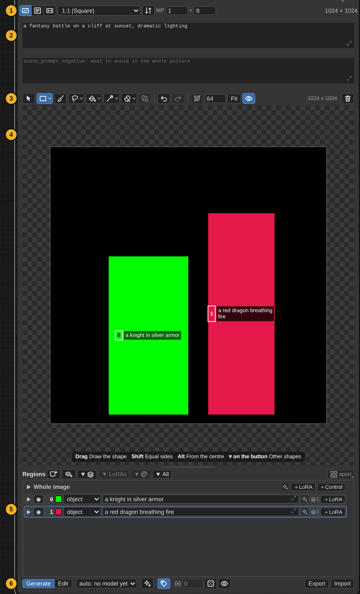

# Region Genie

Paint regions on the node's canvas, give each one its own prompt, and send the result straight to a sampler: the
node outputs the model, the encoded prompts and the latent, plus masks, boxes and a color map for other nodes.

## Your first image

1. Connect your loader's `model`, `clip` and `vae` to the node.
2. Pick a shape (**R** for a rectangle) and drag a box on the canvas. That is your first region.
3. Type what belongs there in the region's prompt, in the list under the canvas.
4. For another region, press the add-region button (a box with a plus, above the list) and draw again.
5. Describe the whole picture in `scene_prompt_positive`.
6. Connect `model`, `positive`, `negative` and `latent` to your sampler, and run.

## The parts of the node

1. **Image size**: by aspect ratio, from a list of presets, or typed in.
2. **Scene prompts**: the whole picture, and what to avoid. The corner button opens a larger editor.
3. **Tools**: select, shapes, brush, lasso, fill, magic wand / Select object, eraser, arrange; then undo, redo, snap,
   fit and labels. A button with a small arrow holds more versions: click the arrow or right-click.
4. **Canvas**: the image area sits in a checkered margin. The line along its bottom edge shows the keys and gestures
   of the tool in use.
5. **Regions**: one row per region, with its number (the `index` other nodes use), color, type and prompt. The
   arrow at the start of a row opens it: feather, palette, merge, move and delete, then its layers and LoRAs.
   *Whole image* holds LoRAs and Control for the whole picture.
6. **Bottom bar**: Generate / Edit, the model, the LLM Prompt Enhancer, tag autocomplete, the wildcard seed, and
   Export / Import. After a run, a button here shows what the run reported, with a ⚠ when something needs attention.

## Good to know

- **Which model?** The dropdown in the bottom bar follows the connected model by itself. It decides how the regions
  reach the model: as a layout (MOSS-Image, Ideogram 4) or as plain sentences (Krea 2, Flux, Anima, SDXL / SD1.5).
- **apart** (right of the list's header) keeps the regions from blending into each other on plain-text models. It
  turns on by itself when it is needed; click it to turn it off for this node.
- **Edit** (bottom bar) changes an existing image on the `image` input instead of making a new one.
- **Nothing is lost by trying:** Ctrl+Z undoes every change in the editor, Clear all included.
- **Shortcuts** work while the pointer is over the node: V select, R / O / T shapes, B brush, L lasso, F fill,
  W magic wand, Q Select object, E eraser, G snap, Home fit, Space+drag pan, wheel zoom.
- Every button explains itself when you point at it, and the defaults for new nodes are in
  **Settings > Region Genie**.

## More

The full manual: [Region Genie](https://github.com/TheGhostOfSmittyWerbenjagermanjensen/ComfyUI-Region-Genie/blob/main/docs/region-genie.md), [Control](https://github.com/TheGhostOfSmittyWerbenjagermanjensen/ComfyUI-Region-Genie/blob/main/docs/control.md),
[Edit Mode](https://github.com/TheGhostOfSmittyWerbenjagermanjensen/ComfyUI-Region-Genie/blob/main/docs/edit-mode.md), [Regional LoRAs](https://github.com/TheGhostOfSmittyWerbenjagermanjensen/ComfyUI-Region-Genie/blob/main/docs/regional-loras.md),
[LLM Prompt Enhancer](https://github.com/TheGhostOfSmittyWerbenjagermanjensen/ComfyUI-Region-Genie/blob/main/docs/llm-prompt-enhancer.md), [Wildcards](https://github.com/TheGhostOfSmittyWerbenjagermanjensen/ComfyUI-Region-Genie/blob/main/docs/wildcards.md).
